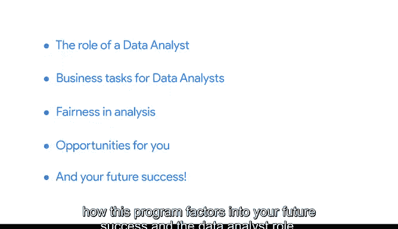

# 谷歌数据分析师1《基础： 数据，数据，无处不在》foundations-data - P26：26_04_01_聚焦商业实践.zh_en - GPT中英字幕课程资源 - BV1UN411S7yZ

Hey， great to have you back now it's time to get down to business we're going to start talking about practical ways businesses are using data and the opportunities that it can create for you so far you've learned a lot of practical data analysis skills。

🎼With these next couple of videos， we're going to switch gears a little and talk about why you're learning these skills Hopefully this will give you more perspective into what kinds of opportunities are out there for you Com up。

 we're going to talk more about the kinds of roles data analysts play in different industries。

 the tasks that these roles require and the importance of fairness and avoiding bias in analyzing data for business tasks we'll also talk about opportunities you can tap into and how this program factors into your future success and the data analyst role So with all that in mind。

 let's get started。

