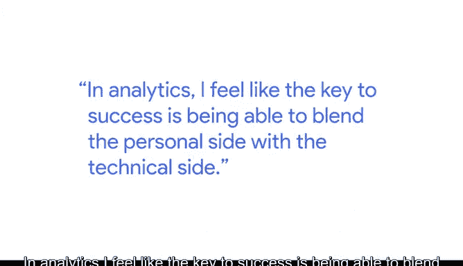

# 谷歌数据分析师1《基础： 数据，数据，无处不在》foundations-data - P28：28_04_03_Joey的数据分析师成长之路.zh_en - GPT中英字幕课程资源 - BV1UN411S7yZ

Hi， I'm Joey and I work as an analytics program manager within Ruuse。

Now Rue stands for Real estate and Work Services。 And my job is to bring data and analytics into the decision making here。

 especially with regards to creating a safe and fun work environment。

 My journey into analytics was a bit different in that。

 I had no plan or really didn't see myself being where I am now。 Now， luckily。

 I started in a rotational program called the HR program within people operations。

 which afforded me the ability to play three different roles。Essential。

 I was in a generalist capacity in a specialist role and as an analyst。

 And I really found a love in a passion in the analytical work。😊。

I started on the business intelligence team， whose job was to provide sequL based reporting back to the business。

 I realized that analytics is the right career path for me when I found myself enjoying coming to work and getting my work done。

😊，And I think I can connect that to two passions of mine。 The first is problem solving。

 I love taking a complex problem， a mystery， a riddle and being able to find the answers and come up with the solution。

😊，And then the second thing is being able to work with people and help people in analytics。

 I feel like the key to success is being able to blend the personal side with the technical side。

At the beginning of my career， I focused a little more on the technical pieces。

 and I wanted to make sure I had the right technical knowledge to be able to answer questions。

But what I found is over time， I needed to grow that other side just as much。

 And I think that my career has allowed me those opportunities to kind of work each of those muscles。

 the human interaction part and the technical part to make sure that they're both growing at the end of the day。

