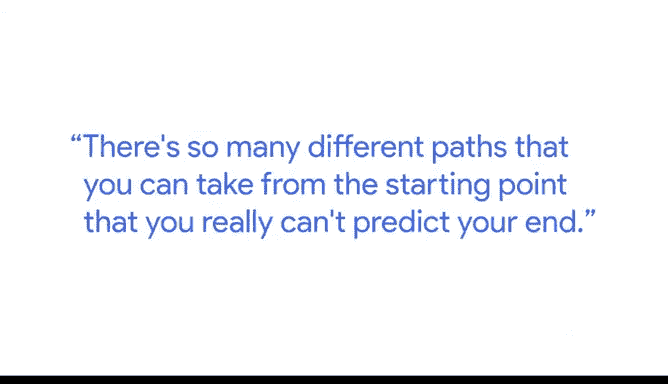

# 谷歌数据分析师1《基础： 数据，数据，无处不在》foundations-data - P29：29_04_04_Tony谈数据职业发展支持.zh_en - GPT中英字幕课程资源 - BV1UN411S7yZ

For any analyst， for any person that's honestly at the early stages of their career。

 understanding data， respecting data and knowing how to work with data is incredibly important because。

You knowMy vision is that every role in some form of fashion will involve data and its use in learning how to extract insights from it will be at the core of any critical role across any company organization。

 generally in the first two years， you're developing the core skill sets that make you a fantastic generalist and then in the next two to five years。

 you're learning about something very specific as it relates to your job。

 so whether it's the area that you're supporting or maybe a very technical component。

 like let's say you want to become a SQL expert so that you can manipulate large data sets for financial analysis purposes。

 similarly， even if you come into finance as a data analyst。

 you can pop out a finance and go into what a lot of people like to call the business。

 which is typically your operations functions and become a business analyst or a data analyst。

There's so many different paths that you can take from the starting point that you really can't predict your in。

I'm just deeply passionate about working with and supporting young people and really giving them a jumpstar to their career。

This stems from honestly my own personal experience where in the first two years of my career。

 I had essentially zero support from my manager and my direct management chain。

 having gone through that experience in my first two years， I realized。

 and I felt to experience how that can slow you down。

And especially when you're somebody that has a lot of potential and a lot of ability。

 you want to be be in an environment that fosters that ability and really wants to see you grow。

 I think it's incredibly important to have programs like these that take away all the barriers that remove any of the constructs that prevent people from being able to find out what they need to be in an industry like this。

 to be successful in a role like a data analyst so that they themselves can dream about where they can go in their career。

 My name is Tony。 I'm a finance program manager at Google。

