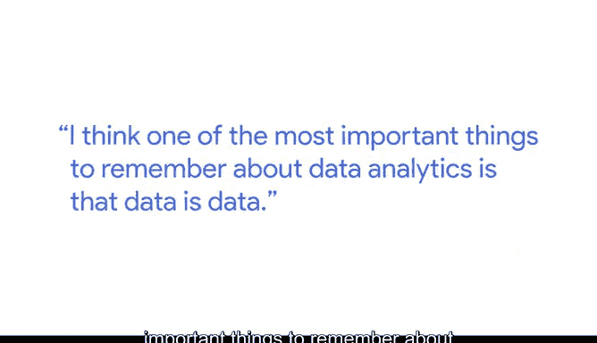
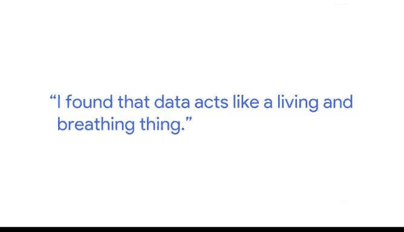

# 谷歌数据分析师1《基础： 数据，数据，无处不在》foundations-data - P31：31_04_02_Rachel谈数据侦探工作.zh_en - GPT中英字幕课程资源 - BV1UN411S7yZ

Hi， my name is Rachel and I'm the business systems and analytics lead at Verily。

 There are a lot of different types of problems that a data analyst can solve。

 I've been lucky enough over my career to have to have seen a lot of them and to take in a lot of very different types of data and help turn that into meaningful answers。

 I think one of the most important things to remember about data analytics is that data is data。

I am a finance data analyst。 And so my role at Verily is to take all of our financial information。

 All of the information of the money we're spending and the money we're making and turn that into reports and insights so that our business leads can understand what we're doing。

 One of the most important things I've done it Verily recently was help create what's called a profit and loss statement for each of our business units。

 And that means that in real time our teams can see what their budget is and how their' spending against that budget。

 And what that does is that helps our teams keep to that budget by either increasing their revenue stream so that they have more money to play with or pulling back their spending so that they can keep themselves within that budget and all of that really helps keep us on track as a company and making sure that we're hitting our goals。

 I've found that data acts like a living and breathing thing。

When you have a ton of data points， it can be overwhelming when you first sit down to make sense of it。

 You have tons of columns， tons of records， tons of different types of data。

 and finding a way to make sense of that is really hard。

 And that's where the expertise of a data analyst comes in。

 It has been some of the most frustrating moments of my career。

 but also some of the most rewarding work I've ever done when it finally comes together。

 The best advice I have for any data analyst starting out is keep at it。

 If the angle you're taking doesn't work。 Try to find another one。

 Try to come at it in a different way。 try to ask a different question。 Eventually。

 the data will yield。 and you'll get the insights you're looking for。

