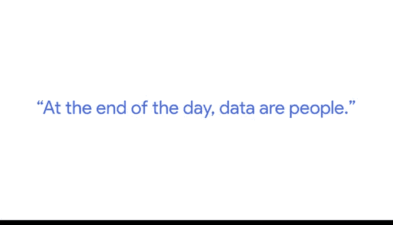

# 谷歌数据分析师1《基础： 数据，数据，无处不在》foundations-data - P33：33_04_05_Alex谈公平与道德数据决策.zh_en - GPT中英字幕课程资源 - BV1UN411S7yZ

Hi I'm Alex I'm a research scientist at Google my team is called the ethicalical AII team and we're a group of folks that really are concerned not only about how AI and the technology operates。

 but how interacts with society and how it might help or harm。Marginalized communities。

 So when we talk about data ethics， we think about， you know。

 what is the good and right way of using data， what are going to be ways that are going to be uses of data that are going to be beneficial to people when it comes to data ethics。

 It's not just about minimizing harm， but it's actually this concept of beneficence。

 how do we actually improve the lives of people by using data。When we think about data ethics。

 we're thinking about who's collecting the data， why are they collecting it。

 how are they collecting it and what for what purpose。

 because of the way that organizations have imperatives to make money or to report to somebody or provide some kind of analysis。

 we also have to keep strongly in mind how this is actually going to benefit people at the end of the day。

Are the people represented in this data going to be benefited by this？

 And I think that's the thing you never want to lose sight of as a data scientist or a data analyst。

 I think aspiring data analysts need to keep in mind that a lot of the data that you're going to encounter is data that comes from people。

 So at the end of the day， data are people and。

You want to have a responsibility to those people that are represented in those data。

 Second is thinking about how to keep aspects of their data protected and private。

We don't want to go。Through our practice， thinking about data instances as something we could just throw on the Web。

 No， there needs to be considerations about how to keep that information and likenesses like their images or their voices or their or their text。

 How do we keep that private。 We also need to think about how。

We can have mechanisms of giving users and giving consumers more control over their data。

 it's not going to be sufficient just to say we collect all this data and trust us with all these data。

But we need to ensure that there's actionable ways in which people can consent to giving those data and ways that they can ask for it to be revoked or removed。

 So data is growing and at the same time， we need to empower people to have control over their own data。

 The future is that data is always growing， we haven't seen any kind of evidence that data is actually shrinking。

 and with the knowledge that data is growing， these issues become more and more peaked and more and more important to think about。

