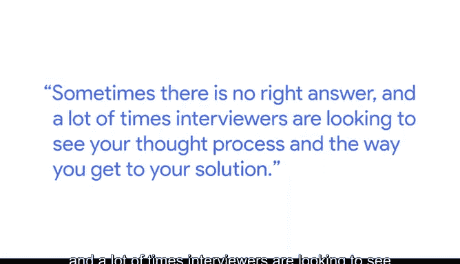
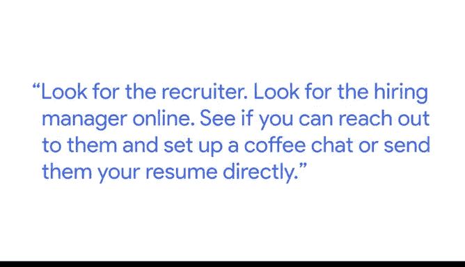

# 谷歌数据分析师1《基础： 数据，数据，无处不在》foundations-data - P35：35_04_03_Samah访谈最佳实践.zh_en - GPT中英字幕课程资源 - BV1UN411S7yZ

My name is Samma Moy and I'm a recruiter here at Google for the large customer sales team basically I hire talent for the sales team here even within the sales recruiting space I recruit specifically for the analytical lead roles here at Google I want the candidate to be as comfortable as possible as a recruiter I'm also their advocate if they're a good fit for the team I'd like to present them in the best light as a recruiter。

Some advice I would give for a data analyst that's just starting to look for a job。

 think about a time where you've used data to solve a problem。

 whether it's in your professional or personal projects。

Another tip I would say for a data analyst that's just looking for a new job is to increase your professional network。

There are many ways to increase your professional network。

 One of them is to increase your online footprint， reach out to other analysts on LinkedIn。

 join local meetups with other data scientists。 Sometimes when we're looking for really a unique skill set。

 recruitcers are going on websites like LinkedIn and Github and trying to find that talent themselves。

 It's really important to have your LinkedIn updated along with websites like Github where you can showcase a lot of the data analyst projects you've done。

Another tip I would say for an in person interview is to prepare questions for the interviewer。

Make sure they're not broad questions they should be questions that will help you understand the team and the job better if you're given a case study in an interview。

 you should expect to be given a business problem along with the sample data set then you'd be asked to take that sample data analyze it and come up with a solution one of the things you can do to help prepare yourself for this is to ensure you are analyzing the data and coming up with a solution that relates back to that data Sometimes there is no right answer and a lot of times interviewers are looking to see your thought process and the way you get to your solution。

I highly encourage that if you find a role that you're interested in， not only apply to it。

 but go the next step， look for the recruiter， look for the hiring manager online。

 see if you can reach out to them and set up a coffee chat or send them your resume directly。

Online applications could be a really。Big black hole where you never hear back from the recruiter or the team when you reach out directly to a hiring manager or recruiter。

 it really shows your eagerness for the role and your interest for the role。

 even if sometimes you don't get a response from that from reaching out。

 you never know it's you know you try multiple different times and that one time you get a response back from a recruiter or hiring manager could be the time you get the job that you really wanted。

