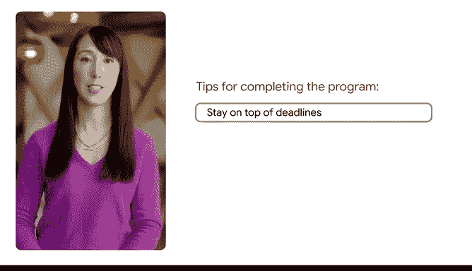
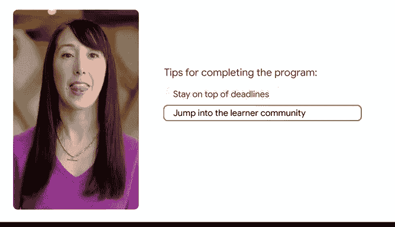
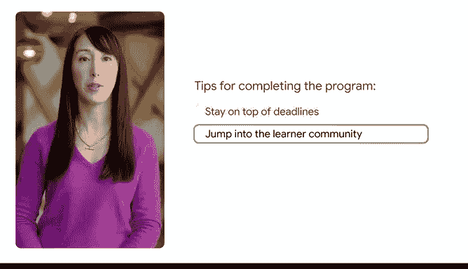
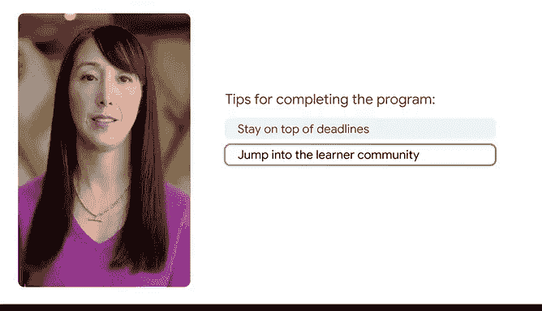

# 谷歌数据分析师1《基础： 数据，数据，无处不在》foundations-data - P3：03_01_04_开启您的谷歌数据分析证书之旅.zh_en - GPT中英字幕课程资源 - BV1UN411S7yZ

Hi there。 I'm Amanda from Grow with Google。 We're the team behind the Google Career certificates。

 and we're thrilled you've decided to pursue yours in data analytics。

 Expts here at Google created this program to help you develop skills that prepare you for jobs。

 Once you complete your certificate， you'll join a community of over1 million graduates who are launching their new careers and you'll instantly unlock resources to help you launch yours。

 This includes an industry recognized credential from Google that can be added to your resume and your professional profiles like LinkedIn。

 We're also here to support you along the way as you navigate your job search。

 We know there's a lot involved in finding a new job。

 So include at the end of the certificate program。 You'll find a course that shows you specific ways to use AI to streamline your search。

 You'll identify your transferable skills。 update your resume for different roles and practice interviewing all with the help of AI Plus for learners in the United States。

 you can sign up for one on one career coaching and access thousands of job postings through career circle at No cost。

😊，These valuable resources are exclusively for Google career certificate graduates。

 starting strong is the best way to ensure you complete the program and can access these resources。

 Here are a few of our top tips to get you to the finish line。 First， stay on top of the deadlines。

 especially in these early weeks。 learners who do this are almost twice as likely to finish their certificate。

 Second， jump into the learner community right away。

 This is a great place to get advice and connect with other learners like you。

 Having this community as a resource to turn to if you get stuck。

 significantly boosts your chances of success。 And finally。

 don't get discouraged if you face challenges。 It happens。 remember what brought you here。

 take advantage of the support available to you and know that with persistence， you've got this。

 for the latest from Google on career advice。 Ias for how to use AI and notifications about new courses。

 Subscribe to our newsletter at grow Google slash updates。

 We wish you the very best as you embark on this exciting。😊。

ourneyAnd we look forward to supporting you as you earn your Google Career certificate。

