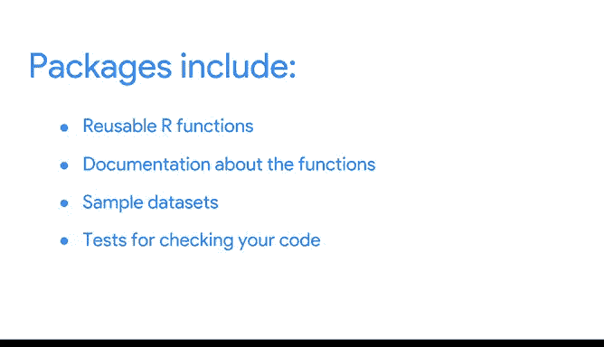
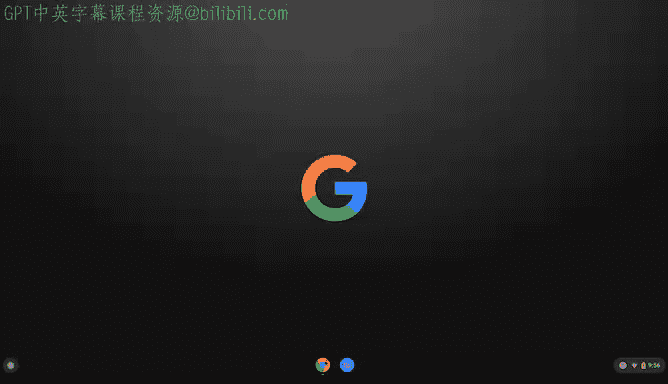
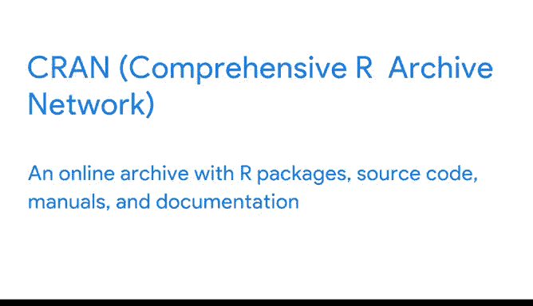
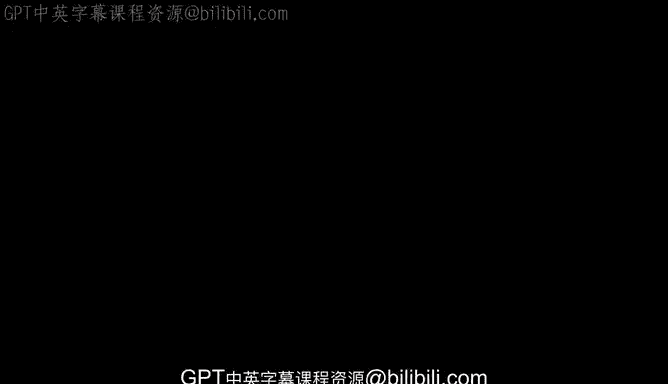

# 谷歌数据分析师第七课《使用R编程进行数据分析》data-analysis-r（中英双字） - P10：10_02_01_持续赋能的数据工具.zh_en - GPT中英字幕课程资源 - BV1bg4y1P7AQ

Hello there。 I have to say， getting a package delivered to you is one of life's simple pleasures Doesn't matter if it's a surprise package or something you ordered yourself。

 It's exciting to open your package to discover what's inside。

 No wonder those unboxing videos on YouTube are so popular。😊，While。

 R has a different kind of package that our users can open。

 These packages are units of reproducible R code， and they make it easier to keep track of code。

They're created by members of the R community to keep track of the R functions that they write and reuse。

These community members might then make the packages available to other users。

 It's one of the great things about being part of this community。

Packages in R include reusable R functions and documentation about the functions。

 including how to use them。They also contain sample data sets and tests for checking your code to make sure it does what you want it to do。

By default， R includes a set of packages called base R that are available to use an R studio when you start your first programming session。

There's also recommended packages that are loaded， but not installed。

Before using functions from one of these packages。You'd have to load it with a library command like library Bo。

 for example。Let's find out which packages we already have in our studio。

 We'll work in our console instead of a script for now。

 because we're practicing and don't need to save this code for later。

To check out our packages， we'll just run the command installed dot packages。And there's our list。

 Let's focus on the package and priority columns。 The package column gives the name of the package。

 like cluster， or graphics。The priority column tells us what's needed to use functions from the package。

If you come across the word base in the priority column。

 then the package is already installed and loaded。You can use all of the functions of that package as soon as you open our studio。

If you find the word recommended， then the package is installed， but not loaded。

You'll also notice a list of packages in the bottom right part of our workspace。

 This list includes a brief description of each package。

To load class and other uninstalled packages will need to use the library function。

 followed by the name of the package。And now the class package has a check next to it。

 So it's been successfully loaded for use。 If you want to learn even more about your loaded packages。

 you can click on their names in the packages tab。 This opens the help tab and shows topics related to the package you selected。

😊，You can also use the help function in your programming to call up the Help tab。

While the pre installed packages give you tons of useful functions。

 there's even more packages that'll further expand your programming abilities。

You can find thousands of R packages just by doing an online search。

One of the most commonly used sources of packages is crran。

Cran stands for Comprehensive R Archive Network。It's an online archive with our packages。

 source code， manuals and documentation。

When you start working with R， you'll be able to do your own searches to find packages in Cron or elsewhere。

It's almost always easier to just search with your favorite search engine， though。

So packages are a pretty big part of using R。 They give you most of what you need to complete your programming throughout the data analysis process。

Who knows you might even turn your own code into packages for others to use？Up next。

 we'll keep unpacking our packages， see you soon。

