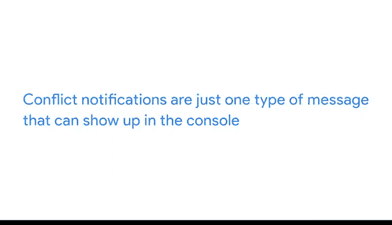
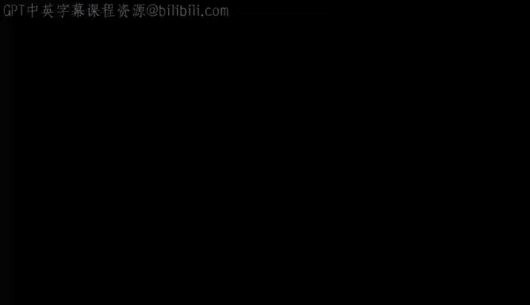

# 谷歌数据分析师第七课《使用R编程进行数据分析》data-analysis-r（中英双字） - P11：11_02_03_Tidyverse生态介绍.zh_en - GPT中英字幕课程资源 - BV1bg4y1P7AQ

Welcome back。 As we discussed earlier， packages are a big part of what makes our so great。😊。

Packages offer a helpful combination of code， reusable R functions， descriptive documentation。

 tests for checking operaerability and sample data sets。And for lots of data analysts。

 at the top of the list of useful packages is tidyverse。

Tidyverse is actually a collection of packages in R with a common design philosophy for data manipulation。

 exploration and visualization。Using Tidiverse can help you work your way through pretty much the entire data analysis process。

 the packages in tidiverse work together naturally。

I started learning about tidyverse when I was working on a survey project。

 It felt like I was stepping into a more advanced zone of R。 I understood the basics。

 but now I was finding out how the tidy verse improves on the basics。

 That's when I got even more excited about working in R。😊。

I realized that the more I put into learning about the tidy verse， the more I'd get out of it。

On top of that， the community support for Tidyverse is strong， too。

 It's one of the reasons why Tidyverse is considered a key part of programming for most R users。

 The principles associated with Tidyverse， which you'll learn both here and at your job。

 have been widely adopted by the R community。You'll find lots of tutorials and examples related to the tidyverse online that show you these principles and how they're applied to data analytics。

 Okay， let's install the tidyverse。 You can follow along on your own using your R studio cloud account。

 Check out the reading for more details。Earlier， you learned how to find base R packages using the function installed packages。

To install packages like the tidyverse that aren't in base R willll use the install packages function。

As we discussed earlier， this function calls the tidy verse and other packages from Crran。

Let's talk about why CRayran was created。Since packages， not in base R， are mostly made by R users。

 people need a reliable way to check and validate submitted code。Cran。

 makes sure any R content open to the public meets the required quality standards。

 So if it's sourced through Crran， you can feel good that the package is authentic and valid。

Another major source of packages and other art content is Gitthub。

Now we'll get back to installing the tidy verse。 We'll first type install dot packages。

 Then between the parentheses， we'll type tidy verse in quotes。The quotes aren't always necessary。

 but best practice is to use quotes to make sure that we are accurate。

 We'll press enter and wait for our studio to install tidy verse。When we click on our packages tab。

 we come across a lot of new packages on the list。That's tidy verse。

 You might have noticed that none of the packages are checked off。

We need to load them first before we can use them。But that's a mighty long list。

 So let's just load the package named Tidyverse for now using the library function。

The return shows that not only was Tidy verse loaded， but eight other packages were， too。

 It also shows a list of conflicts。 Conflicts happen when packages have functions with the same names as other functions。

Basically， the last package loaded is the one whose functions will be used。

 So we'll stick with the tidyverse functions。 but it's important to note that these messages only appear once。

 So as you get more use to R， you'll be able to figure out if you want to use certain functions over others。

The loaded packages are G G plot 2。Tibbble， tidy R。Read R per。Deply R， string R， and forecasts。

These packages are the core of the tidy verse because you'll use them in almost every analysis。

 All of them work together to make your data analysis smooth and efficient。With these packages。

 Tidiverse helps you do everything from importing and transforming data to exploring and visualizing it。

We'll check out this core of packages soon and we'll use them even more as we continue working in our studio。

If you're working on your own and R， you can check out some of the other packages， too。

The packages available in tidyverse change a lot， but you can always check for updates by running tidyverse。

 underscore， update， open parentheses and close parentheses in your console。

 you can then update the packages in a couple of ways。 If you use the update packages function。

 it'll update all of your packages。 That might take a while。

 So if you just want to update one package。 You can use the install packages function again with the package name as your argument in parentheses。

You should update packages regularly to make sure you've got the latest version in your code。

 Conflict notifications are just one type of message that can show up in the console。

You might find warnings and error messages as well。

A quick search using the help tab will usually tell you what the message means and what， if anything。

 you'll need to do to address it Coming up， Well keep moving through the tidy verse。

 You'll find out more about why tidy verse is such an integral part of R。Seef。😊。

