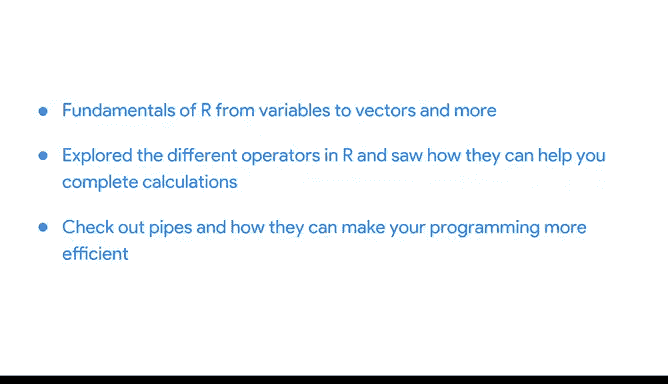

# 谷歌数据分析师第七课《使用R编程进行数据分析》data-analysis-r（中英双字） - P12：12_02_01_Tidyverse进阶应用.zh_en - GPT中英字幕课程资源 - BV1bg4y1P7AQ

Great， you're back。Have you ever taken a tour of a famous landmark or an unfamiliar city？

It can be pretty exciting。You get to learn all about the features of the landmark or city。

Eventually you get to know them pretty well and you can share what you learned with others。

While we're here to take a different kind of tour， a tour of the tidy verse。For this tour。

 we won't be traveling anywhere special， but we will help you learn about the exciting。

 tidyverse features。😊，And once you know them a little better。

 you can most definitely share what you learned with others。For this tour。

 we'll focus on the core packages of tidy verse we discussed earlier。G G plot 2， tidy R， Read R。

 Dly R， Tibble。Per。String R and forecast cats。We also learned how to install and load them in our studio。

Once they're loaded， you won't need to do anything else with their actual packages。

They'll do their thing as you program。So what is their thing？Well， it depends。

But there's four packages that are an essential part of the workflow for data analysts。Ggi plot 2。

D p R。Tidy R and read R。You'll most likely use these more often than the others G G Pot 2 is used for data visualization。

 specifically plots。With G Gplot 2， you can create a variety of data viz by applying different visual properties to the data variables。

Here's an example of GG plot2 in action。You'll have your own chance to use GGplloot 2 later。

Tidy R is a package used for data cleaning to make tidy data。We covered tidy or clean data earlier。

 but as a quick reminder， it's data where every part of a data table or data frame is the right type in the right place。

 Tidy R works with wide and long data to make sure this happens。 Next， we have read R。

 which is used for importing data。The most common function from ReadR is read， underscore CSV。

This will import a CSV file into R。A CSV file contains data separated by commas in a table format。

To accurately read a data set with read R， you combine the function with a column specification。

The column specification describes how each column should be converted to the most appropriate data type。

It's good to keep in mind。 This isn't usually necessary because read R will figure it out for you automatically。

We'll come across radar functions as we continue to explore R。Now， on to D I R。

DlyR offers a consistent set of functions that help you complete some common data manipulation tasks。

For example， the select function picks variables based on their names。

 and the filter function finds cases where certain conditions are true。 And， yes。

 Dly R is another package we'll get to later。There's plenty to look forward to。

 So that's the fab4 of the tidy verse。 They'll all make your programming in R more straightforward and efficient。

 The other four packages are definitely useful， too， but you might not use them as often。😊。

Tibbble works with data frames。Per works with functions and vectors。

 helping make your code easier to write and more expressive。

String R includes functions that make it easier to work with strings。

Forcas provides tools that solve common problems with factors。As a quick reminder。

 factors store categorical data in R， where the data values are limited and usually based on a finite group like country or year。

Using the tidy verse and its packages will help you fine tune your analysis。And besides tidy verse。

 you also learned the fundamentals of R from variables to vectors and more。

You explored the different operators in R and saw how they can help you complete calculations。

You had the chance to check out pipes and how they can make your programming more efficient。

And you unpacked packages to find out how they're a big part of what you can do in R。

We've covered a lot of ground in just a few videos。

 so this might be a good time for you to do a little review。

You can rewatch videos and revisit any other resources that can help you get an even better grasp of all the terms。

 concepts and processes that are part of R。Looking ahead， you'll start working with data in R。

 including a more thorough exploration of how tidyverse impacts your process。 You'll see Tibble。

 readar and other tidyverse packages in action。And you'll find out how to clean and organize your data in R。

All this and more coming up。 I'll see you soon。

