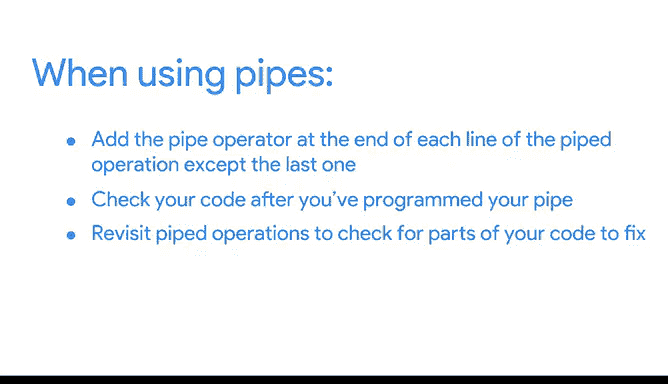
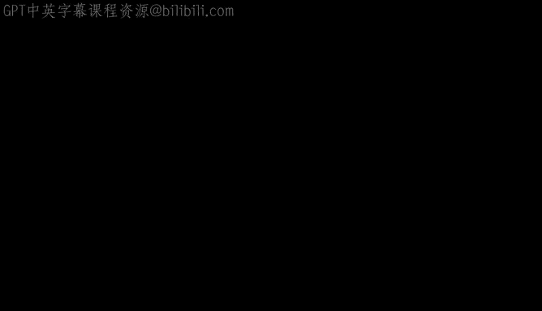

# 谷歌数据分析师第七课《使用R编程进行数据分析》data-analysis-r（中英双字） - P13：13_02_02_管道操作实现代码嵌套.zh_en - GPT中英字幕课程资源 - BV1bg4y1P7AQ

Hi， again。Earlier， we introduced something called pipes。

 A pipe is a tool in R that helps make your code more efficient and easier to read and understand。

In this video， we'll explore pipes in more detail。As a quick reminder。

 a pipe is a tool in R for expressing a sequence of multiple operations。 In other words。

 it takes the output of one statement and makes it the input of the next statement。

So instead of typing out functions contained inside other functions。

 you can use the pipe operator to do the same work。In programming， we describe this as nested。

Nest it describes code that performs a particular function and is contained within code that performs a broader function。

You can think of a pipe as a way to code the phrase and then。Say you've got sales data。

 and you need to find the mean or average。 you can create a pipe by calling up the data and then grouping the data and then summarizing the group data using a mean function。

Let's check out an example。 First， we'll open our studio。

Then we'll start a new script so we can save our work。 We'll save it as tooth growth exploration。

We'll use the tooth growth data set， which is already installed in R。

This data set contains data about the effect of vitamin C on the growth of teeth in guinea pigs。

It's a well known data that'll help us learn about how pipes work。

To load any data set already installed， we use the data function。

 We then add the name of the data set， tooth growth。Now that the data is loaded。

 we can check it out with the view function。Notice how V begins with the capital V。

 It's a good reminder that functions and variables are k sensitive in R。In a script。

 we use the run button to run our code。 The return usually shows up in the console。 but with view。

 a new tab appears in the script showing the contents of the dataset。Now。

 let's say we need to filter and sort this data to organize it for analysis without pipes。

 we could do this either by nesting commands or by creating a sequence of data frames。

 We'll chat more about data frames soon。 Let's start by filtering the data set。

Note that we'll want to first install and load the correct filter function。

 which comes as part of a package。Installing a package may take a few moments。

This function comes as part of the D p R package。 Well assign a name to the new dataset set and then apply the filter function。

This filters the data so that we only see rows where the dose of vitamin C is exactly 0。5。

This includes both types of vitamin C used in the study， orange juice or OJ in our data set。

 and aorbic acid or VC。Next， we'll sort it with the Arrange function。

Will include the name of the filtered data set， followed by the column name we want to sort by。

 In this case， Le， which stands for length of tooth。When we run this。

 the return appears in the console。The data is arranged in ascending order by Le。

The return only shows row where the dose amount is 0。5。

So the data hass been filtered and sorted based on our code。

 let's try another way to get the same return。Will'll use a nested function。

 which is a function that is completely contained within another function。

Here's the nested function for filtering and sorting this data set。

Notice that the filter function from our previous code is the nested function with nested functions we read from the inside out。

The code filters the data first， then it arranges or sorts it。Now， let's run this。

We tweaked the code， but we get the same result。Now we'll use a pipe。As a quick reminder。

 the operator used to call out a pipe is a percentage sign。

 followed by a greater than sign and another percentage sign。

You can also use keyboard shortcuts to insert pipe operators。

 control shift M for PCs and Chromebooks， and command Shi M for Max。

We'll start this pipe by assigning it to a variable。

Then we'll type the name of the data set we're pulling data from toothg。

 We'll use our keyboard shortcut to add the pipe operator after that。Now。

 we can press enter to go to the next line。 Our studio automatically indentense the next line。

 recognizing that it's part of the pipe。Next， we'll filter the data。

We don't have to call out the data set inside parentheses， like we did in earlier examples。

 because we started our pipe with it。 The pipe automatically applies the data set to each step。

All right， let's finish up our pipe on a new line with the Arrange function and sort the data。

Since this is our last line of code， we don't need a pipe operator。Finally， click Run。

Our pipe is set up to call the data set and then filter the data set and then sort the data set。

 All three methods work。 But you can see how pipes help make your programming more efficient and less cluttered。

This means fewer chances for mistakes and better readability for anyone looking at your code。

And because of the structure of a pipe， we can easily add to or change the code without having to start over。

And Presto， we get the same return as our other methods。So let's do that building on our example。

 let's say we also wanted to compute the average tooth length or L for each of the two supplements used in the study。

 orange juice or OJ and a sobic acid or VC。We'll replace the arrange function with the group by function。

This will group our results by the two supplements， so we type S in the parentheses and add a pipe。

We're adding a pipe this time because we have another line of code to add。So we group by。

 and then we summarize our argument， which comes after the function summarize， looks pretty complex。

 but it basically tells R what to do with missing values and to make sure the data is grouped the right way when we add the summarize function。

Now we'll run our new pipe and get the average length of tooth when the dose is equal to 0。

5 for each of our supplements。Nice， now there's a couple of things to remember when using pipes。

 First， it's important to add the pipe operator at the end of each line of the piped operation。

 except the last one。Another group rule of thumb is to check your code after you've programmed your pipe。

Remember， our studio automatically indentense lines of code that are part of a pipe。

If a line in your code isn't indented， it probably hasn't been added to the pipe。

That could lead to an error statement。Then you can revisit the Pid operation to check for parts of your code to fix。

With the other methods we showed you， it'd be more of a challenge to find the messy parts。

 Another reason to use pipes when you can。Pipes or piping。

 and the functions that are part of the piping process are building blocks for putting together analyses in R。

In upcoming videos， you'll learn how you can use these building blocks to clean。

 transform and analyze your data。For now， feel free to take your time reviewing and maybe even practicing with the functions。

 operations and other elements in R and R studio that we've already covered。

