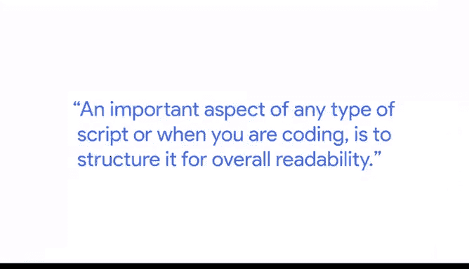
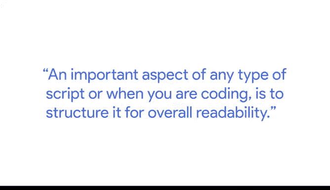
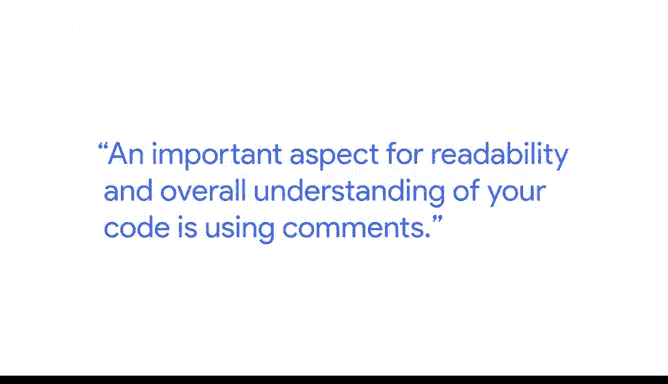
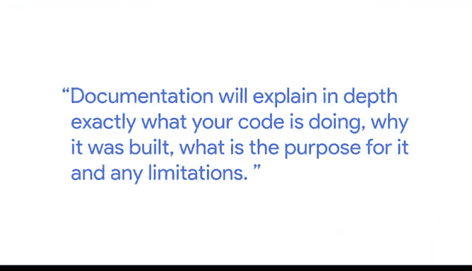
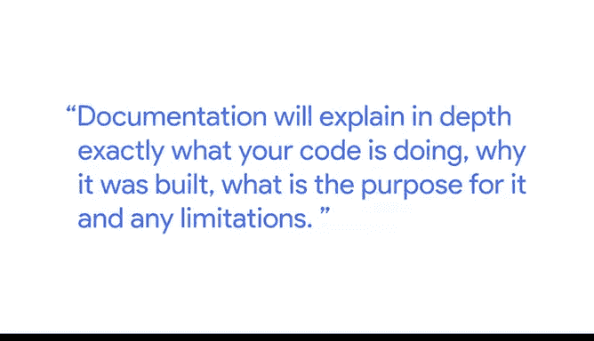
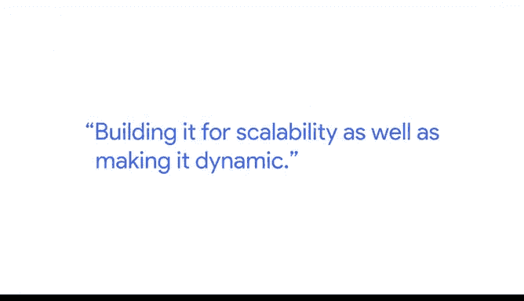

# 谷歌数据分析师第七课《使用R编程进行数据分析》data-analysis-r（中英双字） - P14：14_02_04_Connor的编程技巧分享.zh_en - GPT中英字幕课程资源 - BV1bg4y1P7AQ

Hi， I'm Connor， and I'm a marketing analytics manager at Google Cloud。

 I was running into barriers of not being able to do certain analysis because it was too time consuming with my limited technical knowledge。

 so I started to teach myself things like SQL to help me access data through the current company's database that I had so that I could manipulate that data to better understand it。

 I can tell you at first it is an incredibly frustrating thing to move through because it takes a lot of time and effort to do something that seems very simple or something that would be very easy to do in spreadsheets but may be very difficult to do at first is you're learning how to code but also one of the most fulfilling things that I've ever done because once you're able to understand something。

 it opens up an entire new realm。 Learn coding was revolutionary for my job。

I remember when I first started as an analyst。All of the data that I used was in spreadsheets and I had to run analysis and create formulas to manipulate the data。

 understand the data and even analyze the data Now， when we started to get more and more data。

The formulas that I would have run would take hours。 And I remember at one point I had。

 I spent a few hours creating a formula and then executed it。 and it took over 10 hours to run。

 So I left my computer open。And let it run throughout the night， woke up。

 and it was still running fast forward a year later， after I had learned SQL and Python。

 I was able to run the same type of analysis in milliseconds。

 So really understanding what it is that。😊，You are trying to do。

Coding helps you manipulate and analyze data at a rate that previously or without a coding knowledge would be very difficult to do one important aspect of any type of script or when you are coding is to structure it for overall readability。

More often than not， you're going to be working on a team。

Now it's important that when you're writing a script。That's you understand how it works。

 but also that somebody else who you work with can also come and understand what it is that you are trying to do within that script。

Now。It's very important that it not only works and is efficient， but that it is also not too verbose。

 meaning that it is not overly complex， So an important aspect of readability is if you are looking through your code and you realize that I have written the same thing multiple times。

 or I'm using the same logic or algorithm multiple times。

 that is a point in time where you can really consolidate your code and make it a lot more concise。

 which vastly helps with readability， vastly helps anybody who comes and is trying to read your code and that includes you two weeks from now。

 because I can promise you when you start coding， you will realize that what makes sense to you right now。

 may not make sense to you three weeks from now， an important aspect for readability and overall understanding of your code is using comments。

Comments are a way to write something out in a standardized language like English and a way that somebody can understand it。

 but the computer doesn't pick up as actual code， so for explaining every line that you write or explaining an entire section of your code in a comment allows somebody to walk themselves through your code。

And read exactly what it is that you are trying to accomplish with the code that you've written。 Now。

 without comments， you are leaving it up to the person to really follow your code and understand it themselves。

 which may not be an easy task for somebody because they may have a different way of coding the same thing that you are doing。

 Documenting your work is an important aspect。 Documentation will explain in depth exactly what your code is doing。

 why it was built。 What is the purpose for it and any limitations。

The last one is a。Rather difficult concept to understand as you are first diving into learning a coding language。

 and that is building it for scalability as well as making it dynamic。

Now， when I say building something for scalability， what I mean is。

If you are building a specific script。Of code to solve a task that you're running now。

 what you want to be sure of and answer is， will this code or could this code be used？

In the future for something else。 now， if it is， it's important that you make your code available to be scalable。

 That means that it is efficiently run so that if the size of the data that it is running any manipulations on increases。

 It doesn't bog down your code too much and that it can handle large data loads is well as small。

 Another aspect to that is making your code dynamic。So what that means is not。

Hard coding any values within your code that don't change when they need to。

 So these are just a few of the best practices。 And as you continue down your path as a data analyst。

 you'll pick up many， many more。 There's always more to learn。 There's always more to understand。

 but this should help you in beginning down your path to understanding coding。

