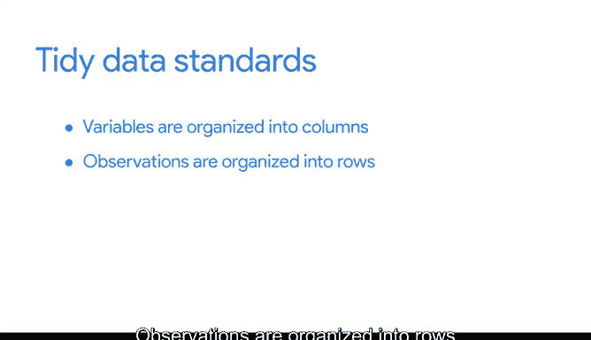

# 谷歌数据分析师第七课《使用R编程进行数据分析》data-analysis-r（中英双字） - P16：16_03_02_R数据框详解.zh_en - GPT中英字幕课程资源 - BV1bg4y1P7AQ

Hey， welcome back。Before we can start cleaning and organizing our data， or even check it for bias。

 we need to get our data into a usable format。This is where data frames come in。You might remember。

 we talked a little bit about data frames before。In this video。

 we'll learn more about what data frames are and how you can use them。Let's get started。First。

 let's talk about what a data frame is。A data frame is a collection of columns。

 It's a lot like a spreadsheet， or a SQL table。Here's an example of a data frame in R。

It's a lot like other tables we've worked with throughout this program。

There's column names and rows and cells with data。The columns contain one variable。

 and the rows have a set of values that match each column。

We use data frames for a lot of the same reasons as tables too。

They help summarize data and put it into a format that's easy to read and use。

There's some things to know about data frames， before working with them。

We'll learn more about data frames throughout this program， but this is a great starting point。First。

 column should be named。Using empty column names can create problems with your results later on。

Let's think back to our example。Each of the columns are named based on the variable they represent。

There's carrot， cut， color， clarity， depth。All of these columns represent data about the diamonds。

Next， it's important to know that the data stored in your data frame can be many different types like numeric。

 factor or character。Often data frames contain dates， timestamps， and logical vectors。Finally。

 each column should contain the same number of data items。

Even if some of those data items are missing。Data frames are foundational。Now。

 let's talk about tibbles in the tidy verse， Tbbles are like streamlined data frames。

 They make working with data easier， but they're a little different from standard data frames。First。

 Ts never change the data types of the inputs。They won't change your strings to factors or anything else。

You can make more changes to base data frames， but Tbbles are easier to use。

This saves time because you won't have to do as much cleaning or changing data types and tibbles。

Tips also never change the names of your variables， and they never create row names。Finally。

 Ts make printing an R easier。They won't accidentally overload your console because they're automatically set to pull up only the first 10 rows and as many columns as fit on screen。

Super useful when you're working with large sets of data。

Data frames and tibbles are the building blocks for analysis in R。

 So having set standards for how they're built and dealt with is pretty important。

If we all have the same understanding of what a data frame is， we can communicate more effectively。

It's like we're all speaking the same language。It's also just a lot more practical。

We need to be able to do things like define columns and review code easily in R。

These characteristics make it easier to share your data and reproduce your analysis。

Consistent data structures like data frames make it easier to operate on an entire data set。

Tidy data refers to the principles that make data structures meaningful and easy to understand。

It's a way of standardizing the organization of data within R。

These standards are pretty straightforward。Variables are organized into columns。

 Observations are organized into rows， and each value must have its own cell。

Now that you know a little more about data frames， let's start using them。Coming up。

 I'll teach you how to create data frames， add data to them， and expand them。Bye， for now。

