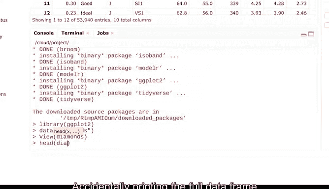

# 谷歌数据分析师第七课《使用R编程进行数据分析》data-analysis-r（中英双字） - P17：17_03_03_数据框操作实践.zh_en - GPT中英字幕课程资源 - BV1bg4y1P7AQ

Hey there。Earlier， we learned about data frames and their key characteristics。 Now。

 we'll actually start working with them。As a data analyst。

 a lot of your work will depend on data frames。 If you don't create a data frame。

 your ability to work with your data will be limited。Think about spreadsheets。

 that basic structure of columns and rows carries over to R。

Data frames are basically the data analyst's default way to interact with data。

That's why knowing how to create and work with data frames is so important。

So let's check out an example。Here we'll use R's built in data frames。

One of the great things about R and R packages is that there's a lot of interesting。

 easy to access data sets built in。These data sets let you practice some of the tools we've been learning。

Let's open our studio and get started。Willll use a pre loaded data set with information about diamonds。

 This data sets part of the G G P 2 package in the tidyverse。 So make sure you first load G G P 2。

We'll learn how to load our own data sets later， too。

 But diamonds is a good data set to practice with。We can load this data now by using data open and close parentheses。

 You might notice that when we start to type diamonds。

 our studio gives us the option to select it from its drop down menu。

 That's because this data set already exists in our library。 Okay， now。

 let's add this data frame to our data viewer。There's 10 columns and 100 rows in this data frame。

 but we might not want to see all of it。We can use the head function to give us just the first six rows。

 This is a nice preview of the entire data set。😊，Accidentally printing the full data frame to the console can be annoying and can take a long time to compute。

You can avoid printing the full data frame by using functions like head to get a quick preview。

 We can also get the structure of the data frame， using functions like structure and call names。

These are just two functions you can use to check out your data。

 We'll explore other functions like glimpse later on。 For example。

 we could use the structure function to highlight the structure of this data frame。😊。

This gives us some high level info， like the column names and the type of data contained in those columns。

But if we just want to know the column names， we can use call names instead。Here we have carrot， cut。

 color， clarity， depth， all of the columns included in this data set。

 We can also use the mutate function to make changes to our data frame。

 The mutate function is part of the D pr package， which is in the tidy verse。😊。

So you'll need to load the Tidyverse library before you test out mutate。Let's add a new column first。

 All we have to do is input， mutate， and then tell R。

 we want to add a new column to the diamonds data frame。Well first call， mutate。

Followed by the name of the data frame， we want to change。

Then we'll add a column and the name of the new column we want to create。

Then we want to calculate this new column。In this case。

 to make it easier to read the carrot column we'll multiply it by 100 to create a new column carrot underscore 2。

And when we run this， Presto， our data frame has a new column。

 You won't lose any columns when you create the new one。

 The rest of the data frame will still be the same。

Data frames are usually the starting point for analyzing data in R。

 So it's important to understand the characteristics of data frames and how to create them。Great job。

 And I'll see you next time。