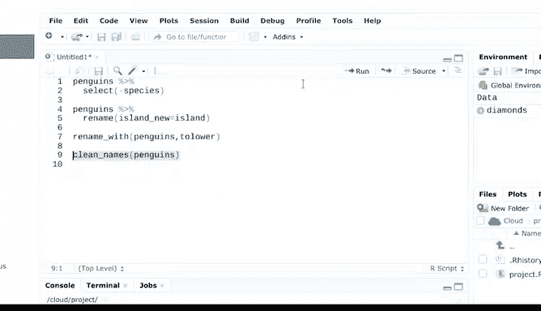

# 谷歌数据分析师第七课《使用R编程进行数据分析》data-analysis-r（中英双字） - P18：18_03_01_基础数据清洗方法.zh_en - GPT中英字幕课程资源 - BV1bg4y1P7AQ

Hi again。Now that we've got a little more experience with data frames。

 we can start doing some interesting things like clean， standardized， manipulate and visualized data。

We'll go through some common tasks that you'll perform as a data analyst。

 But we're just scratching the surface of what you might want to do in R。

We'll start with the basics and learn how to clean up our columns。

 There will be a reading with a handy list you can refer to afterwards， too。 Let's install the here。

 skimmer and janitor packages now。We'll go ahead and open our console。 First。

 we'll add the here package。 This package makes referencing files easier。To install it。

 we'll just write install dot packages。 And then in the parentheses， we'll put here。

And our studio will install it。After we install it， we'll also need to load it using library。Next。

 we'll install Sm R and janitor。 As a quick reminder， these packages simplify data cleaning tasks。

 They're both really useful。And do slightly different things。

 The skim R package makes summarizing data really easy and lets you skim through it more quickly。

 We'll install it now。The janitor package has functions for cleaning data。After it's done installing。

 we'll still need to load it。Finally， we want to make sure the D IR package is loaded since we're going to be using some of its features。

There， now we've got all the packages we need for basic data cleaning。Now， let's load some data in。

Later， when you're practicing with your own data， you can use read to grab a file。 For example。

 if you had a CV you wanted to load， you could write read， underscore CSV。

 and input the file name in the parentheses。This is where the here package comes in handy。

So be sure to install and load the here package before trying to save CSV files。For now。

 we'll load a really fun package to practice with the Palmer penguin package。😊。

This is a data set we've used before。 But just as a quick reminder。

 the Palmer penguin data has lots of information about three penguin species in the Palm archipelago。

 including size measurements， clutch sizes and blood isotope ratios。 And who doesn't love penguins。

First， we'll install the package， so we'll type install dot packages and input Palmer penguins。

And then remember to load it by using the library function。

 And now that we've got this data loaded into our library。

 we can try some cleaning functions on our columns。

There's a few different functions that we can use to get summaries of our data frame。

Skim without charts， glimpse， head， and select。The skim without charts function gives us a pretty comprehensive summary of a data set。

 Let's try it out。When we run this， we get a lot of info back。 First。

 it gives us a summary with the name of the data set and the number of rows and columns。

It also gives us the column types and a summary of the different data types contained in the data frame。

 Or we could use glimpse to get a really quick idea of what's in this data set。

When we run this command， it'll show us a summary of the data。There's 344 rows， and 8 columns。

We have species， island， measurements for bills， which are basically beaks and flippers。

The penguin's body mass and grams， the sex。 And finally， the year the data was recorded。

We can also use head to get a preview of the column names and the first few rows of this data set。

Having the column names summarized like this will make it easier to clean them up。

We can use select to specify certain columns or to exclude columns we don't need right now。

Let's say we only need to check the species column。We can input penguins。

 Then a pipe to indicate will add another command and our select。

 We'll jump back into an R script because it will be easier to see。

Now we have just the species column， or maybe we want everything except the species column。

Will put minus species instead of species。 And now we have every column but species。

 The select statement is useful for pulling just a subset of variables from a large data set。

This lets you focus on specific groups of variables。

There's a lot of other select functions that build on this that we'll cover later on。

Now that we know our column names， we've got a better idea of what we might want to change。

The Rename function makes it easy to change column names。Starting with the penguin's data。

We'll type rename and change the name of our island column to Island underscore new。Now。

 looking at our column names， we can see the column name has changed。

Or let's say we want to change our columns so that they' are spelled and formatted correctly。

In spreadsheet programs， as long as our column names are meaningful， they're fine。

But since we have to type the column names over and over in R， we need them to be consistent。

 similar to the rename function。 The rename with function can change column names to be more consistent。

For example， maybe we want all of our column names to be an upper case。

We can use the rename width function to do that。This will automatically make our column names uppercase。

 But since variable names are usually lowercase， we'll use the to lower option to change it back。

The clean names function in the janitor package will automatically make sure that the column names are unique and consistent。

Let's try theC namess function on our penguins data。

This ensures that there's only characters， numbers and underscores in the names。 And now。

 you know some functions for cleaning columns in your data sets。

Try practicing them on your own with the Palmer penguins data。

And once you're comfortable with these functions， we'll learn even more about data cleaning in R。

See you soon。

