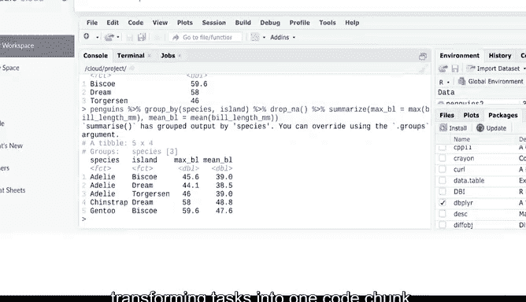

# 谷歌数据分析师第七课《使用R编程进行数据分析》data-analysis-r（中英双字） - P19：19_03_04_数据整理与组织.zh_en - GPT中英字幕课程资源 - BV1bg4y1P7AQ

Hey， great to have you back。We've learned how to create data frames and perform some basic cleaning functions。

 Now it's time to start getting organized in R。Coming up。

 I'll teach you some functions that'll help you organize and filter your data。

 These functions look a little different in R than in the other tools we've used so far。

But the reason we use them is still the same。 If we don't organize our data。

 we can't turn information into knowledge， organizing our data and comparing different metrics from that data helps us find new insights。

 In other words， it makes our data useful。To help us do this， we'll use the Ar。

 group by and filter functions。Let's start by sorting our data。

We'll keep working with the Palmer Penguins data from earlier。In case you don't remember。

 refer to the link below。We'll also need to load the right packages。

 All the packages we'll need are part of the core tidyverse。 So let's load the core tidy verse now。

We can use the Ar function to choose which variable we want to sort by。For example。

 let's say we want to sort our penguin data by Billlink。We'll type in Arrange and our column name。

And when we execute this command， it'll return a tibble with data sorted by Bill lengths。

It's currently in ascending order if we want to sort it in descending order。

 we just add a minus sign before the column name。And now the longest penguin bill is first。

Now it's important to remember this data is just in our console to save this as a data frame。

 we'll start by naming it。Then we'll input the function we use to arrange the previous version of the penguins data。

When we execute this， it'll save a new data frame。And we can use View penguins2 to add it to our data。

This lets you save cleaned data without losing information from the original data set。

You can also sort by data using the group by function。

Group by is usually combined with other functions， for example。

 we might want to group by a certain column and then perform an operation on those groups。

With our penguin data， we can group by island and then use the summarize function to get the mean bell length。

We checked out the summarize function when we introduced piping， basically。

 the summarize function lets us get high level information about our penguin data。

So let's build our group by statement first。We're not interested in NA values so we can leave those out using the Drop_ NA argument。

This addresses any missing values in our data set。It's important to be careful when using Drop_ NA。

It's useful doing a group level summary statistic like this， but it'll remove rows from the data。

Now let's use summarize， we'll title the summary column meanan Bill length millimeters。

And then we'll build the mean statement。And when we run this。

 we get a data frame with the three islands and the mean bill length of the penguins living there。

We can get other summaries too， for example， if we want to know the maximum bill length。

 we can write a similar function and replace mean with Max。And now we know that the penguin。

 with the longest bill， lived on Besco Island。Both group by and summarize can perform multiple tasks。

 For example， we could group by island and species and then summarize to calculate both the mean and max To do that。

 we can write a similar command。 We'll put species and island in our group by and drop any missing values。

And then we can add a summarize statement with a max and mean calculation。And when we run this。

 we have both groupings and the max and mean。 thanks to piping。

 we can combine all of these cleaning and transforming tasks into one code chunk。

Finally， we can filter results using the filter function。

Let's say we only want data on a daily penguins。 We'll start with the data set we're using。

And then add the filter。You might notice that we're using two equal signs here， that's on purpose。

 the double equal sign means exactly equal to in R。

And now we have a data frame that only contains data on a daily penguins。

 This lets us narrow down our analysis， if we need to。

Being able to clean and organize data is a key step in the data analysis process。

 and knowing the right tool for the job is an important skill for a data analyst。

R makes wrangling data easier and gives you a lot of functionality across the different stages of the data analysis process。

Now that we've cleaned our data， we can get ready to transform it。Coming up。

 we'll learn how to use the separate， unite and mutate functions。

 and how to use them to transform our data in R See you next time。

