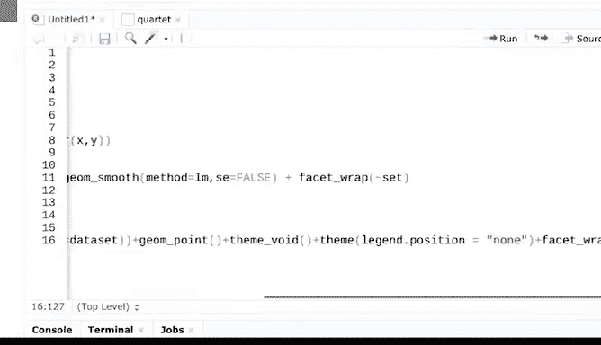

# 谷歌数据分析师第七课《使用R编程进行数据分析》data-analysis-r（中英双字） - P21：21_03_01_同源数据的差异化处理.zh_en - GPT中英字幕课程资源 - BV1bg4y1P7AQ

Great to have you back。Earlier， we talked about summarizing data in R。

 and we even used the summarize function to calculate the mean for one of our penguin data variables。

Now， we'll work with a very famous data example， An scbe's quartet。

Ascope's quartet has four data sets that have nearly identical summary statistics。

 but those summary statistics might be misleading。Data visualizations。

 especially for data sets like these， are so important they help us discover things in our data that would otherwise remain hidden。

Plus， you'll discover some of the ways R can create awesome visualizations。

Let's install the packages。 This may take a few minutes to load。Okay。

 let's load the anscombe's quartet data now。When we view this data。

 we notice that there's four sets of x and Y axes in the data frame。 That's the quartet。

Data can be summarized by different statistical measures。

We'll get a summary of each set with the mean standard deviation and correlation for each of these data sets。

We'll start by indicating that we want to group our data by set。

Then we'll input our summarize function。When we run this。

 we'll get a summary of these statistical measures。In our summary table， we can check the mean。

 The mean for x in each data set is 9。And the mean for y is 7。5。

The standard deviation can help us understand the spread of values in a data set and show us how far each value is from the mean。

The standard deviation for x and Y in every set in the quartet is the same。3。32。And 2。03。Finally。

 we've got our correlation， which shows us how strong the relationship between two variables is。

Here it looks like the correlation between x and Y in all four sets is around 0816。

So based on the summaries we created with our statistical measures， these data sets are identical。

 but sometimes just looking at the summarize data can be misleading。

Let's put together some simple graphs to help us visualize this data and check if the data sets are actually identical。

You'll learn more about plotting data in our later。 but for now。

 we'll just get a quick idea of how this data appears。Check it out。

 These four data sets appear quite different when we visualize them。

If we'd just gone with a statistical summaries， we never would have known that this data is actually really different。

I want to show you one more really cool thing。The dataaurus package。

The dataaurus creates plots with the anscom data in different shapes。

But let's run it to see that for ourselves。First， you'll start off with installing and loading the package。

Then we'll create a chart。It's O。 if these commands seem complicated。

 You'll be creating your own plot soon。This is just a sneak peek at how R can help you create data visualizations。

When we run this， it shows us several different plots。 There's the famous dinosaur， a bull's eye。

 a star。 Ours a pretty powerful visualization tool。😊。

You could use the relationships between data points to create many other shapes。As you can see。

 you can do a lot of things with R。Data visualizations， like the ones we just explored。

 help you discover so much more about the data you're working with。

It's important to explore your data in multiple ways to learn a little more about its story。Next。

 we'll learn how to use R functions to check for bias。

