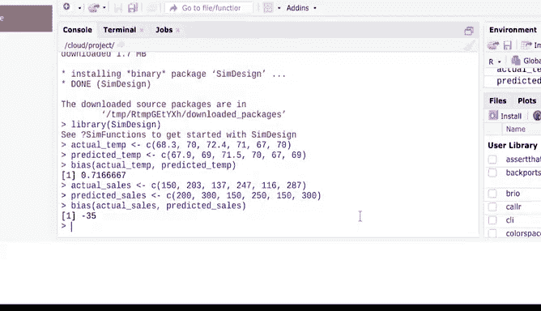
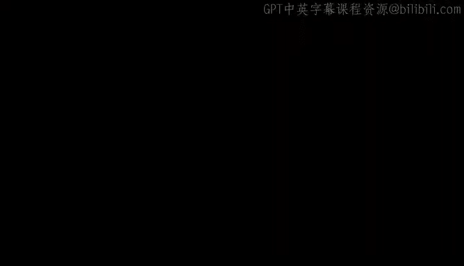

# 谷歌数据分析师第七课《使用R编程进行数据分析》data-analysis-r（中英双字） - P22：22_03_02_偏倚函数应用解析.zh_en - GPT中英字幕课程资源 - BV1bg4y1P7AQ

Hey， welcome back。By now， you've already learned the importance of fair。

 unbiased data in data analysis。In R， we can actually quantify bias by comparing the actual outcome of our data with the predicted outcome。

There's a pretty complicated statistical explanation behind this。 But with the bias function in R。

 we don't have to perform this calculation by hand。 Basically。

 the bias function finds the average amount that the actual outcome is greater than the predicted outcome。

It's included in the Sim design package， so it's helpful to install that and practice on your own。

If the model is unbiased， the outcome should be pretty close to 0。

A high result means that your data might be biased。 a good thing to know before you analyze it。

 Let's say we're working with a local weather channel to determine if their weather predictions are biased。

First， we need to install and load a package called Sim design。

We'll use the bias function to compare forecasted temperatures with actual temperatures。

For this example， we'll just take a small sample of our weather data and input them here。

We'll label this the actual temp。Then we'll put in the predictions。And then， the bias function。

When we run this， we find out that the result is 0。71。 That's pretty close to 0。

But the predictions seemed biased towards lower temperatures。

 which means they aren't as accurate as they could be。

And now that the local weather channel knows about this。

 they can find the problem in their system that's causing biased predictions。

This doesn't mean that their predictions will be perfect all the time。

 but they'll be more accurate overall。Let's try another example。 In this scenario。

 we're working for a game store。 The store has been keeping a record of how many copies of new games they sell on release day。

They want to compare those numbers to their actual sales so that they can find out if they are ordering new stock according to their actual needs。

 Just like the previous example， we will start by inputting our sales data。

 We'll label that actual underscore sales and add the data points。Next。

 we'll input the amount of stock they ordered as predicted underscore sales and input those data points。

And now we have our data ready to go。As you learned in the first example。

 the bias function compares the actual outcome and the predicted outcome of the data to determine the average amount the actual outcome is greater than the predicted outcome。

An unbiased model should be close to 0。Let's run the bias function on our sales data now。

 like before， we'll just type bias to start the function and then actual underscore sales and predicted underscore sales in the parentheses。

When we press enter。Wow， the result is negative 35。 that's pretty far from 0。

The predicted outcome is larger than the actual outcome。

 which means they may be ordering too much stock for release days。

Now that they've used the bias function to compare these data points。

 they can reevaluate their stocking practices to avoid buying more stock than they need at once。

And that's it For now。 We've covered a lot together。 We learned how to create data frames。

 We tried out some basic data cleaning functions。 We got a little preview of how datavis and R can help us better understand our data。

😊，And finally， we learned how to use the bias function。I've still got a lot more。

 I want to tell you about R。And if the data visualizations we created in this module were exciting for you。

 I've got great news coming up， we'll learn all about Data Viz and R。😊，But first。

 you've got a weekly challenge to tackle。 I know you're going to do great。

 And if you want to review any of the material we've covered in these videos， feel free。😊。

This might be the first time you've encountered R， so it's a great opportunity to practice something new。

Your code might throw up some errors at first。That's just part of writing code。

 Learn from our mistakes is how we grow。I'll see you afterwards for our next adventure in R。

