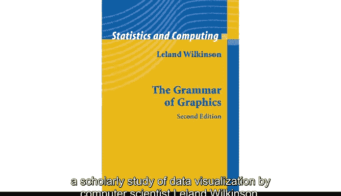
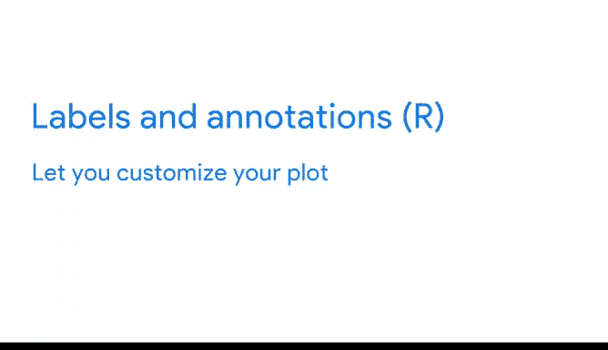

# 谷歌数据分析师第七课《使用R编程进行数据分析》data-analysis-r（中英双字） - P24：24_04_02_R与Tidyverse可视化基础.zh_en - GPT中英字幕课程资源 - BV1bg4y1P7AQ

Hi again。In this video， we'll focus on G plotot2。We'll learn about its main features and functions and how it can help you visualize your data。

First， let's talk about some different visualization packages you can use with R。

Base R has its own package， and there are other useful packages you can add。

They'll help you do almost anything you want with your data from making simple pie charts to creating more complex visuals like interactive graphs and maps。

General purpose packages like plotly let you do a wide range of visualization functions。

Others like RGL， focus on specific solutions， like 3D visuals。

Some of the most popular include Gigi Ploot2， Ply， latticeuce， RGO， diegraphs， leaflet。

 high chartter， patchwork， Gii animate and Gii Riges。Personally。

 G G plotot 2 is my favorite for data analysis。 It's both powerful and flexible。

With a little bit of code， you can create all kinds of different plots。

 You can use G Gpl 2 on its own or extend its powers with other packages。 Plus。

 it's the most popular visualization package in R。 A lot of data analysts prefer to use G Gpl 2。

 which is why we're using G Gplot 2 here。G G Pot 2 was originally created by the statistician and developer Hadley Wickham in 2005。

Wickham's inspiration for creating Gi G P 2 came from the 1999 book， The Grmmar of Graphics。

 a scholarly study of data visualization by computer scientist Leland Wilkinson。

The first two letters of Gi G plot 2 actually stand for grammar of graphics。 And in the same way。

 the grammar of a human language gives us rules to build any kind of sentence。

 The grammar of graphics gives us rules to build any kind of visual。

 So Gi G plot 2 has some basic building blocks that you can use to create plots。In other words。

 when you learn the basic steps for creating a plot in G G plot 2。

 you can reuse these steps to create lots of different kinds of plots。Plus。

 you can add or remove layers of detail to your plot without changing its basic structure or the underlying data。

This makes Gigi Ploot2 really powerful。In the next video， we'll go over these steps one by one。

Ggi plotot2， has lots of other benefits， too。You can create all different types of plots。

 including scatter plots， bar charts， line diagrams， and tons more。You can change the colors。

 layout and dimensions of your plots and add text elements like titles， captions， and labels。

With just a little bit of code， you can create high quality visuals。Plus。

 G G plot 2 lets you combine data manipulation and visualization using the pipe operator。

Ggi Ploot2 also has tons of functions that cover all your data bi needs。To give you an idea。

 check out the Ggi plot 2 Cheee sheet， which is a popular reference guide。

You can find out more about the cheat sheet in an upcoming reading。

It's not important to learn all these functions right away。Or even know what they are。Over time。

 as you get into more advanced data analysis， you can learn about new functions as you need them。

Just know that if you need to find a function for something。Ggi plot2 probably has it。

And like we discussed， even the basic functions of G G plot 2 let you do so much。

We'll focus on some core concepts in G Gplot 2。Aesthetics， geoomes， facets， labels and annotations。

These might be new concepts to you， and that's okay。We'll learn about them together。

 and soon we'll explore each in detail。For now， let's get a quick preview。In Giji plotot 2。

 an aesthetic is a visual property of an object in your plot。For example， in a scatter plot。

 aesthetics include things like the size， shape or color of your data points。

Think of an aesthetic as a connection or mapping between a visual feature in your plot and a variable in your data。

We'll talk more about mapping， later on。A geo refers to the geometric object used to represent your data。

For example， you can use points to create a scatter plot。Bars to create a bar chart。

Or lines to create a line diagram。You can choose a geo to fit the type of data you have。

Points show the relationship between two quantitative variables。

Bars show one quantitative variable varies across different categories。Up next。

 we'll talk about the facet function。Facets let you display smaller groups or subsets of your data。

With facets。You can create separate plots for all the variables in your data。Finally。

 the label and annotate functions let you customize your plot。

You can add text like titles， subtitles and captions to communicate the purpose of your plot or highlight important data。

That's all for now。 Coming up， we'll use code to create our own first plot in Gigipl 2。

