# 谷歌数据分析师第七课《使用R编程进行数据分析》data-analysis-r（中英双字） - P25：25_04_03_ggplot2绘图入门.zh_en - GPT中英字幕课程资源 - BV1bg4y1P7AQ

Welcome back。 In this video， we'll use the Palmer penguins data to learn how to create a plot in Gigi Pot 2。

Earlier， I used this data to give you a preview of what G G Pot 2 can do。

You might remember that the penguins data set contains size measurements for three penguin species that live in the Palmer archipelago in Antarctica。

The data set includes variables such as body mass， flipper length and bill length。Now。

 we'll learn how to use code to create those visuals。

 We'll go through the process of creating a plot step by step。

We'll also go over some general tips on how to write code in Ggiplot 2 and check out some useful help resources。

First， let's log into our studio cloud。As we go along。

 I encourage you to join in and try out all the code in our studio。

 Feel free to pause the video any time you need to。😊。

We're assuming you already have the tidyverse packages installed。If you don't。

 refer to an earlier video or run install do packages， tidy verse。

Let's start by loading the GG Pot2 package and the Penguins dataset set。

Let's check out the plot that shows the relationship between body mass and flipper length in the three penguin species。

The plot shows a positive relationship between the two variables。 In other words。

 the larger the penguin， the longer the flipper。

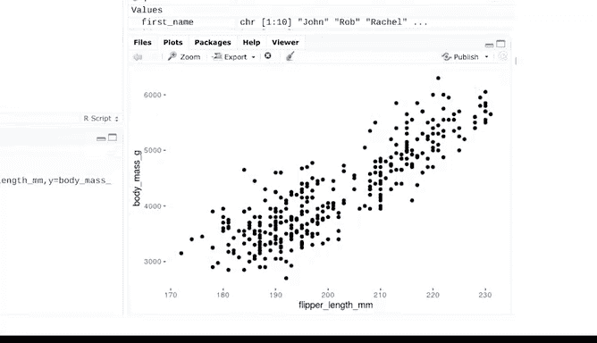

Now， let's check out the code。 The code uses functions from G G P 2 to plot the relationship between body mass and flipper length as a quick refresher in R。

 a functions a name followed by a set of parentheses。

 Lots of functions require special information to do their jobs。😊。

You write this information called the functionss argument inside the parentheses。

The three functions in the code are the G G plot function。The Gome point function。

 and the Ae S function。Every G G plot2 plot starts with the G G plot function。

The argument of the G G plot function tells R what data to use for your plot。

So the first thing to do is choose a data frame to work with。

You can set up the code like this inside the parentheses of the function。Write the word data。

 then an equal sign， then penguins。This code initializes or starts the plot。

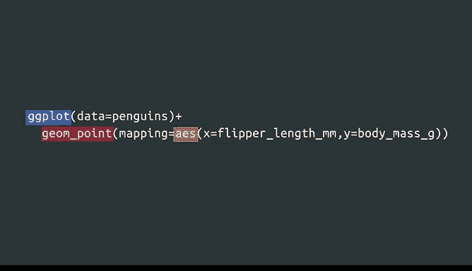

If we stop right now and run the code， the result will be an empty plot。Let's try it。

This is just the first step in creating a plot。

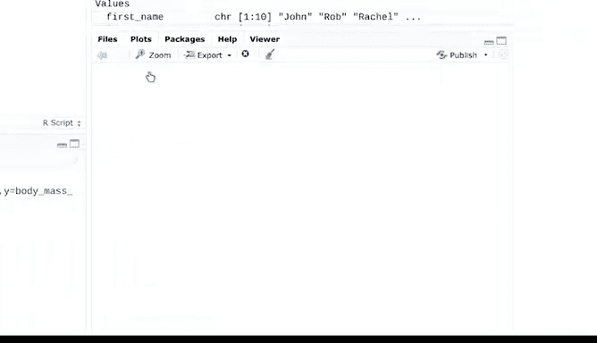

The next thing you might notice about this code is the plus sign at the end of the first line。

 You use the plus sign to add layers to your plot。In Gigi plotot 2。

 plots are built through combinations of layers。First， we start with our data。

Then we add a layer to our plot by choosing a geo to represent our data。

The function Geome underscore point tells R to use points to represent our data。

Keep in mind that the plus sign must be placed at the end of each line to add a layer。

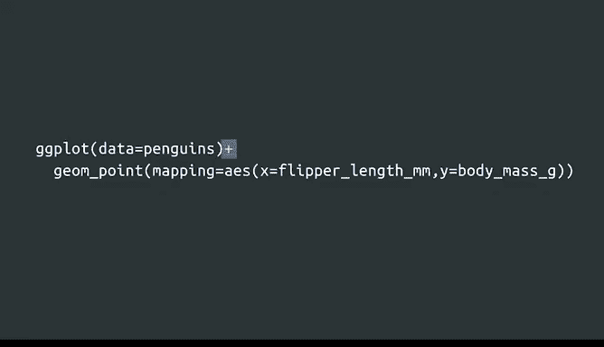

Adding a geo function is the second step in creating a plot。As a reminder。

 a geo is a geometric object used to represent your data。Gomes include points， bars， lines and more。

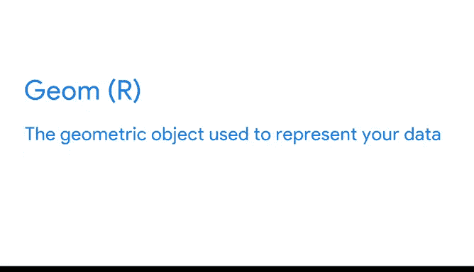

In our code， the function Geome underscore point tells R to use points and create a scatter plot。

We'll learn more about Gomemes， later on。

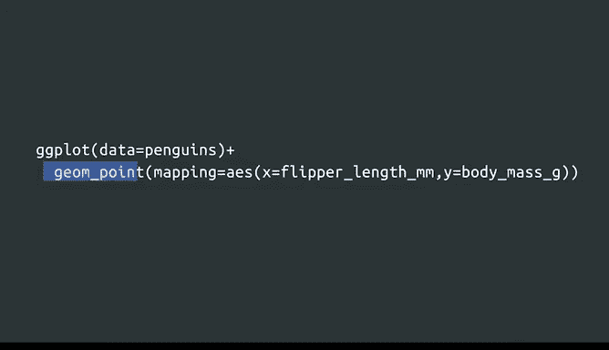

Next， we need to choose specific variables from our data set and tell our how we want these variables to look in our plot。

In Gigi plot 2， the way a variable looks is called its aesthetic。As a quick reminder。

 an aesthetic is a visual property of an object in your plot， like its position， color。

 shape or size。

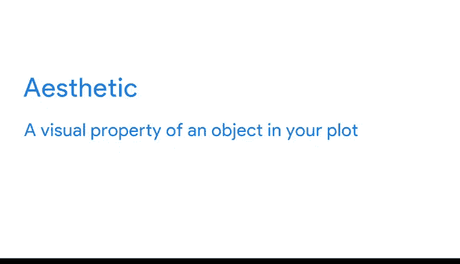

The mapping equals AES part of the code tells R what aesthetics to use for the plot。

You use the AES function。To define the mapping between your data and your plot。

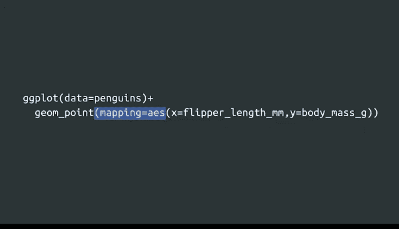

Mapping means matching up a specific variable in your data set with a specific aesthetic。

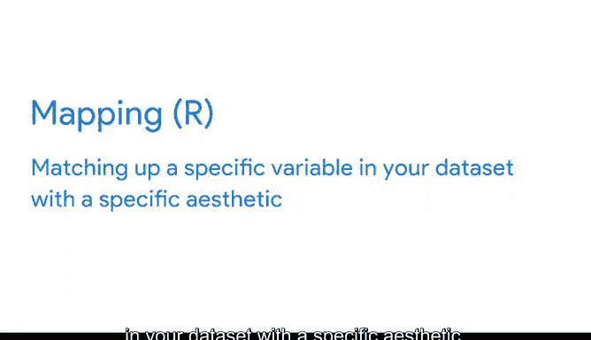

For example， you can map a variable to the X axis of your plot。

 or you can map a variable to the Y axis of your plot。In a scatter plot。

 you can also map a variable to the color， size and shape of your data points。

We'll learn more about aesthetics soon。Mapping aesthetics to variables is the third step in creating a plot。

In our code， we map the variable flipper length to the X axis and the variable body mass to the Y axis。

Inside the parentheses of the AE S function， we write the name of the aesthetic， then the equal sign。

 then the name of the variable。

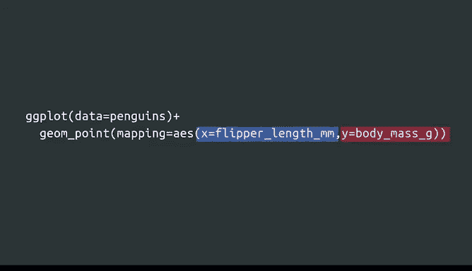

We write the code， and R takes care of the rest。Using the penguins data， R creates a scatter plot。

 puts the variable body mass on the Y axis， and the variable flipper link on the X axis。

Our code follows the common sequence for creating plots in G G Pot 2。Earlier。

 we talked about the grammar of graphics， a set of steps for making all kinds of different plots。

You can also think of this sequence as the basic grammar for making plots in Gigi plot 2。

To create a plot， follow these three steps。Start with the GG plot function and choose a data to work with。

Add a geo underscore function to display your data。

Map the variables you want to plot in the arguments of the AE function。

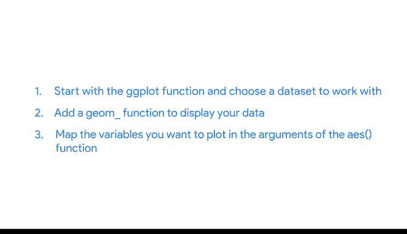

We can also turn our code into a reusable template for creating plots in GG Pot 2。To make a plot。

 replace the bracketed sections in the code with a data set， a Ge underscore function。

 or a group of aesthetic mappings。We can make all kinds of different plots using this template。

 For example， instead of plotting the relationship between body mass and flipper length。

We could use two different variables in the penguins data set。Let's try build length and build depth。

We can put Bill length on the X axis and build depth on the Y axis。

 Let's run the code and check out this new scatter plot。

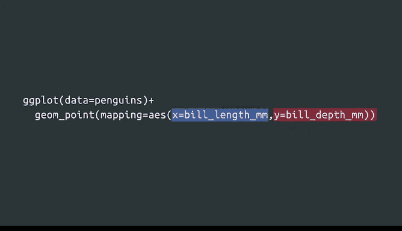

As you learn to write code in R or any other programming language， you'll come across problems。

 It happens to everyone。 I've been working in R for years， and I still write code that has errors。

A lot of times， these will be minor errors with easy fixes。

 It helps if you pay attention to the details。For example， ours case sensitive。

 If you accidentally capitalize the first letter in a certain function， it might affect your code。

Also， make sure every opening parenthesis in your function matches with a closing parenthesis。

Notice how this code won't run correctly。But this code does。

One common problem when working with G G P 2 is remembering to put the plus sign in the right place when adding a layer to your plot。

Always put the plus sign at the end of a line of code。

 It's easy to forget and put it at the beginning of the line。

Or you might accidentally use a pipe instead of a plus sign。We all make mistakes。

 That's part of the learning process。 The good news is， we have plenty of tries to get it right。

 There's also plenty of resources to help you out。😊，To learn more about any R function。

 just run the code question mark， function， underscore name。For example。

 if you want to learn more about the GO underscore point function。

 type in question mark GO underscore point。As a new learner。

 you might not understand all the concepts in the help page at the bottom of the page。

 you can find specific examples of code that may show you how to solve your problem。

If you still can't find what you're looking for， feel free to reach out to the our community online。

As we mentioned earlier， there are tons of great online resources for R。Chances are。

 someone else has had the same problem。

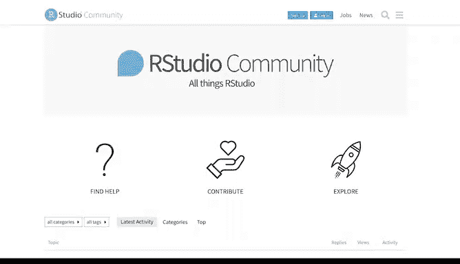

That's it for now。 Up next， we'll learn more about aesthetics。 See you soon。

