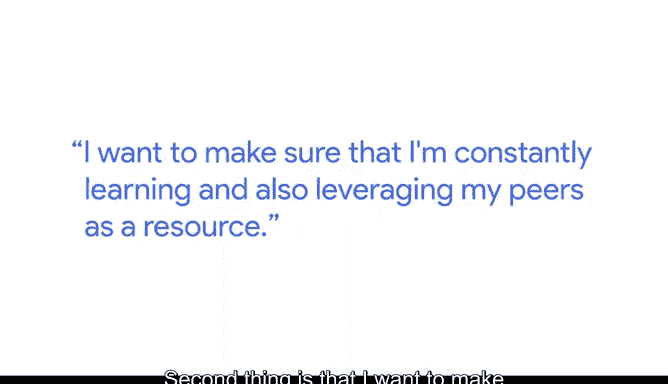
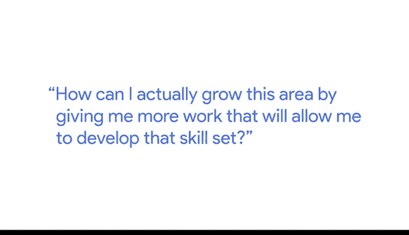
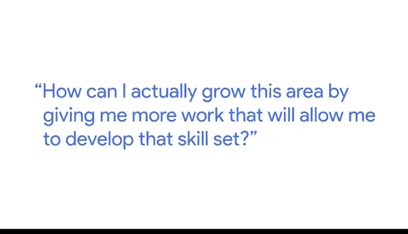

# 谷歌数据分析师第七课《使用R编程进行数据分析》data-analysis-r（中英双字） - P26：26_04_05_Joseph的人力分析职业路径.zh_en - GPT中英字幕课程资源 - BV1bg4y1P7AQ

Hello， my name is Joseph， I'm a People analyst at Google。As a people analyst。

 my job is to work with executives and HR business partners。

To use data to make informed people decisions so my journey to People analytics Let is a very unique one coming from an N school in New York and going to school in Syracuse was a private school。

 the transition was very different in terms of the rig academically and also the social level that I was competing with and just being completely honest I did feel like I didn't belong there。

 I felt the pastster syndrome each and every day。And my first semester I was struggling with my academics because of the lack of strong foundation that I had every time I finished my classes。

 I was seeking for tutoring opportunities， so I was working three times or four times more my peers but the long run actually came to a point where I was doing like much better than my peers and I was the when actually you teaching them also tutoring them on your homeworks when I was going to college my freshman I wanted to major in computer engineering but unfortunately coming from a family of immigrants who did not know what computer engineering was or even saw someone in our community who was really succeeded in that they really discouraged me from pursuing this path again because they didn't went into their risk unfortunately I switched my major from computer engineering into undecided。

 fortunately for me two years later I found another black friend of mine who was also an immigrant African who was majoring information technology and just by me learning from his experience and a class he was taken it really got me really interested in the field。

 I took one intro class。And I really succeeded in that prior to Google。

 I used to work at a company called Accenture， where I was on a consultant doing customer analytics。

 so towards the end，Of my second year at a company I went to a job fair where Google was recruiting there。

 so I spoke to a recruiter and she mentioned to me about this new practice called people analytics。

 which is very similar to where I was doing an essential I just went back home did my research and from there I was really interested in the space that I wanted to develop my career in So since I started Google I just were also honestly say that it was very challenging in terms of the rigor and the difficulties of the work that we were doing so the first thing that was I seek for mentors I knew was interested in my career involvement and also an advocate for myself so by talking to them and just learned a few lessons from them as a way to better maneuver through this space I first gained a lot of courage and also was motivated to even learn beyond the work environment second thing is that I want to make sure that I'm constantly learning and also leveraging my peers as a resource。

So whenever I do get analysis that I need a second opinion on。

 I turn to my teammates who will just make sure they give me the encouragement I need or second opinion for me to better enhance my analysis and I believe the third thing that I always do is that I see for stretch opportunities right so for example I know that theres a space that I'm black and in that I need to develop I make sure that I ask my manager that hey。

 I know that I struggle in this space how can I actually grow in this area by giving me more work that will allow me to develop that skill set。

So I'll say that's a mix of acknowledging that you see a gap in your personal development and also working towards。

Improving that by leveraging the resources around you and just working towards that goal to improve yourself each and every single goal。

Da and O every year as well。