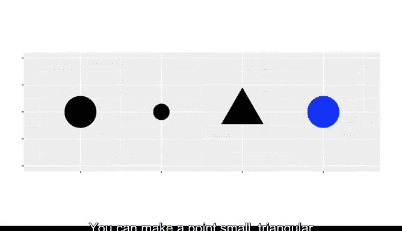
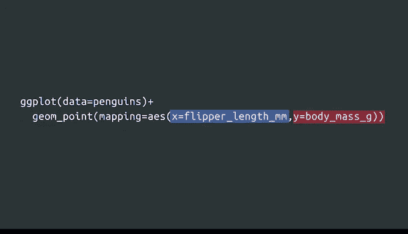
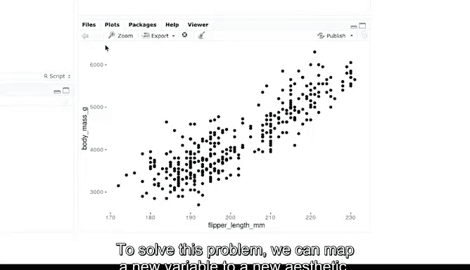
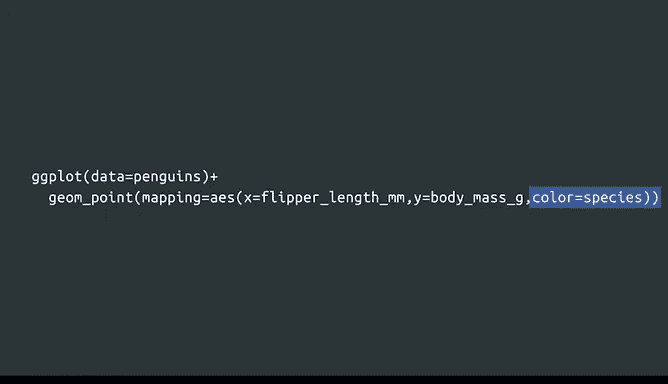
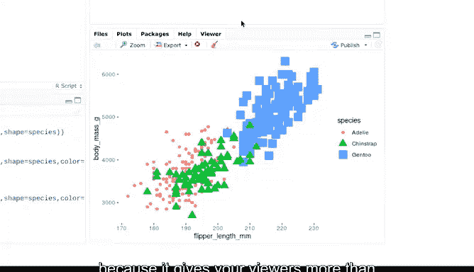
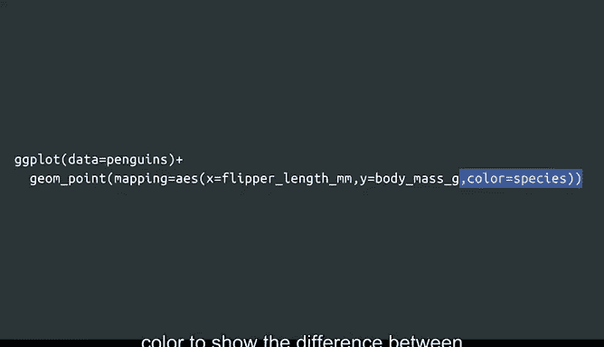
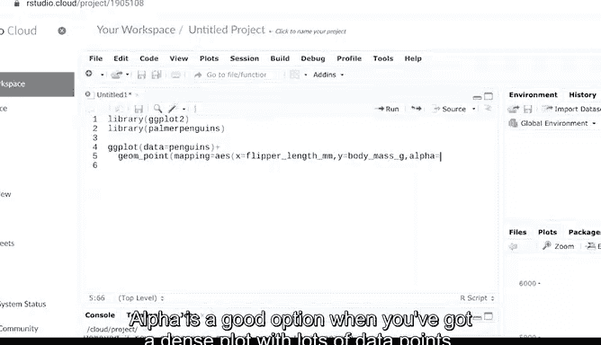
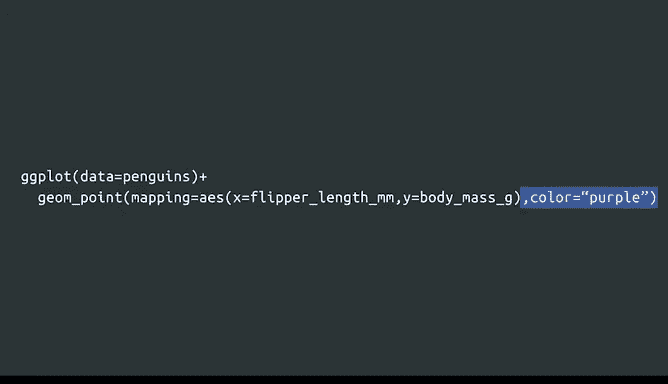
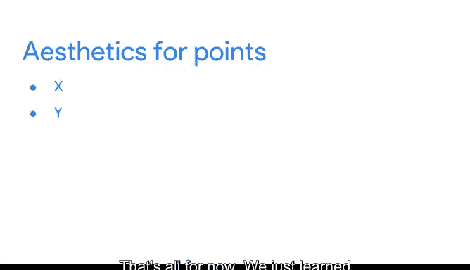

# 谷歌数据分析师第七课《使用R编程进行数据分析》data-analysis-r（中英双字） - P27：27_04_01_R语言可视化增强技巧.zh_en - GPT中英字幕课程资源 - BV1bg4y1P7AQ

Hello again。In this video， you'll learn how to change the aesthetics of your visuals。

 which can help you present your data in a more compelling way。With aesthetics。

 you can highlight key points in your data and communicate more clearly and effectively with your stakeholders。

 Earl， we learned that an aesthetic。😊，Is a visual property of an object in your plot？For example。

 in a scatter plot， aesthetics include the size， shape or color of your data points。

You can display a point in different ways by changing its aesthetics or the way it looks。

You can make a point small， triangular or blue， or a combination of these。

Let's go back to our penguins data set and review the code for our plot that shows the relationship between body mass and flipper length。

As a quick refresher， the mapping equals AES part of the code tells R what aesthetics to use for the plot。

You use the AES function to define the mapping between your data and your plot。

Mapping means matching up a specific variable in your data set with a specific aesthetic。For example。

 you can map a variable to the X axis of your plot。

Or you can map a variable to the Y axis of your plot。To map an aesthetic to a variable。

 set the name of the aesthetic equal to the name of the variable inside the parentheses of the Aes S function。

 R code tells R to map flipper length to the X axis and body mass to the Y axis。

Let's log into our studio cloud and run the code。As a quick reminder。

 let's start by loading the D G Pot 2 package and the penguins data set。

R will automatically place the appropriate label on each axis of our scatter plot。

After you map a variable to an aesthetic， R takes care of the rest。

You can also map data to other aesthetics like color， size and shape。

Right now are plots in black and white。It clearly shows the positive relationship between the two variables。

As the values on the X axis increase， the values on the Y axis increase。

But it's also got some limitations。 For example， we can't tell which data points refer to each of the three penguin species。

To solve this problem， we can map a new variable to a new aesthetic。

Let's add a third variable to our scatter plot by mapping it to a new aesthetic。

Will map the variable species to the aesthetic color by adding some code inside the parentheses of the AE S function。

Well add a comma after the body mass variable。And type color equals sign species。

Our code tells R to assign a different color to each species of penguin。

Let's check it out。The Gents are the largest of the three penguin species。

 The legend just to the right of the plot， shows us that the blue points refer to the Gentu penguins。

Not only does R automatically apply different colors to each data point。

 it also gives a legend to show us the color coding。That's what I love about R。

 Give it just a little bit of code， and it'll go the extra mile to help you out。😊。

We can also use shape to highlight the different penguin species。

 Let's map the variable species to the aesthetic shape。To do this。

 we can change the code from color equal species to shape equal species。Instead of colored points。

 R assigns different shapes to each species。Now， the legend shows us a circle for the a daily species。

 a triangle for the chin straps and a square for the Gents。😊。

You might notice that our plots in black and white again， because we removed the code for color。

Let's put some color back into our plot。If we want。

 we can map more than one aesthetic to the same variable。Let's map both color and shape to species。

 We'll add the code color equals species while keeping the code shape equal species。Now。

 our plot shows a different color and a different shape for each species。We can keep going。

 Let's add size as well and map three aesthetics to species。If we add size equal species。

 each colored shape will also be a different size。Using more than one aesthetic can also be a way to make your visuals more accessible。

 because it gives your viewers more than one way to make sense of your data。

 We can also map species to the alpha aesthetic， which controls the transparency of the points。

Our first plot showed the relationship between body mass and flipper length in black and white。

Then we mapped the variable species to the aesthetic color to show the difference between each of the three penguin species。

If we want to keep our graph in black and white， we can map the alpha aesthetic to species。

This will make some points more transparent or see through than others。

 This gives us another way to represent each penguin species。 Let's try it。😊。

Alpha is a good option when you've got a dense plot with lots of data points。

You can also set the aesthetic apart from a specific variable。

Let's say we want to change the color of all the points to purple。Here。

 we don't want to map color to a specific variable like species。

 We just want every point in our scatter plot to be purple。

So we need to set our new piece of code outside of the AES function and use quotation marks for our color value。

This is because all the code inside of the AE S function tells R how to map aesthetics to variables。

 For example， mapping the aesthetic color to the variable species。

If we want to change the appearance of our overall plot without regard to specific variables。

 we write code outside of the AE S function。Let's write the code， and run it。That's all for now。

 We just learned about the most common aesthetics for points。X， Y， color， shape， size and alpha。

We also discovered how aesthetics can change the look of our plot and highlight important data。

We've covered a lot so far and learned a bunch of new concepts。

 It takes time to process new information and learn new skills。

 So feel free to watch any of these videos again if you need a refresher or want to practice in our studio。

😊，Coming up， we'll learn more about Ges。 See you then。

