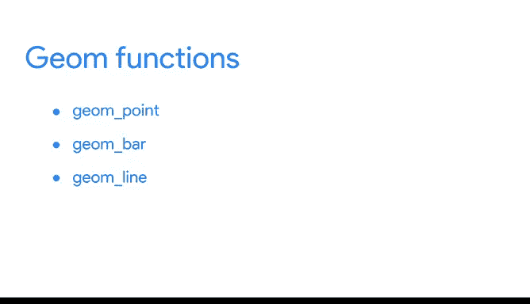
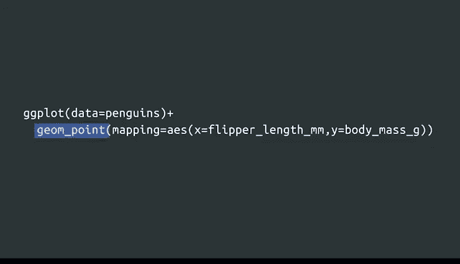
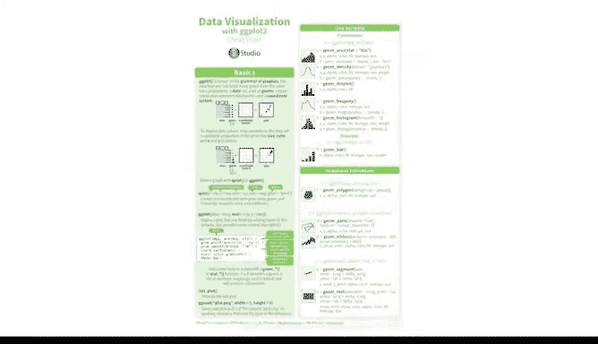

# 谷歌数据分析师第七课《使用R编程进行数据分析》data-analysis-r（中英双字） - P28：28_04_03_ggplot2进阶应用.zh_en - GPT中英字幕课程资源 - BV1bg4y1P7AQ

Great to see you again In this video， we'll learn how to use different Geome functions to create different types of plots。

 such as scatter plots and bar charts。 There are lots of different Geomes available。😊。

You can choose a specific Ge based on how you want to represent your data。

And your goals for communicating it。This lets you tell the story of your data in different ways and communicate effectively to different audiences。

Let's start with two visualizations。 Both visuals contain the same X variable and the same Y variable。

Both use the same data， but each plot uses a different visual object to represent the data。

1 uses points。 The other uses a smooth line。 In other words， they use different geoomes。In GG plot 2。

 a Ge is the geometrical object used to represent your data。Gomemes include points， bars， lines。

 and more。 The Ge underscore point function uses points to create scatter plots。

The Ge underscore bar function uses bars to create bar charts and so on。

To change the G in our plot， we need to change the G function in our code。For example。

 take the plot that shows the relationship between body mass and flipper length。

The code uses G underscore point to create a scatter plot。

Let's log into our studio cloud and watch what happens when we change Ges。 First。

 let's load the G G P 2 package and the penguins data set。

Now we can put G underscore smooth in place of G underscore point。We still have the same data。

But now the data has got a different visual appearance。 Instead of points。

 theres a smooth line that fits the data。The G underscore smooth functions useful for showing general trends in our data。

The line clearly shows the positive relationship between body mass and flipper length。

The larger the penguin， the longer the flipper。We can even use two Geomes in the same plot。

Let's say we want to show the relationship between the trend line and the data points more clearly。

We can combine the code for Geome underscore point and the code for G underscore smooth by adding a plus symbol after Ge underscore smooth。

Let's write the code， and run it。Let's say we want a plot a separate line for each species of penguin。

We can add the line type aesthetic to our code and map it to the variable species。

Gome underscore smooth will draw a different line with a different line type for each species of penguin。

The legend shows how each line type matches with each species。

The plot clearly shows the trend for each species。Finally。

 let's check out the G underscore jitter function。😊。

The Geome underscore jitter function creates a scatter plot and then adds a small amount of random noise to each point in the plot。

Gitttering helps us deal with over plotloting， which happens when the data points in a plot overlap with each other。

Dittering makes the points easier to find。I'll show you what I mean。

 Let's replace G underscore point with G underscore jitter。

Now that we've seen what G G plot 2 can do with scatter plots， let's explore bar charts。

 We'll use the diamonds data set that you're already familiar with。

This includes data like the quality， clarity and cut for over 50000 diamonds。

 This data set comes with the G G P 2 package。 So it's already loaded。To make a bar chart。

 we use the G underscore bar function。Let's write some code that plots a bar chart of the variable cut in the diamonds data set。

Cut refers to a diamond's proportions， symmetry and polish。

Notice that we didn't supply a variable for the Y axis。

 When you use Ge underscore bar R automatically counts how many times each x value appears in the data and then shows the counts on the Y axis。

The default for Geome underscore bar is to count rows。

 but that's only one of the many different applications for bar charts。For example。

 the X axis of our plot shows five categories of cut quality。 Fair， good， very good。

 premium and ideal。The y axis shows the number of diamonds in each category。

Over 20000 diamonds have a value of ideal， which is the most common type of cut。

Gome underscore bar uses several aesthetics that you're already familiar with， such as color。

 size and alpha。 Let's add the color aesthetic to our plot and map it to the variable cut。

We write the code the same way as we did with scatter plots and add color equals cut after x equals cut。

Don't forget to put a comma after x equals cut to add a new aesthetic。

The color aesthetic adds color to the outline of each bar。

Art also supplies a legend to show the colored coating。

Let's say we want to highlight the difference between cuts even more clearly to make our plot easier to understand。

We can use the fill aesthetic to add color to the inside of each bar。In our code。

 we put Bill equals cut in place of color equals cut。

A automatically chooses the colors and supplies a legend。That looks great。

 I really enjoy using the fill aesthetic。😊，If we map fill to a new variable。

 GomeM underscore bar will display what's called a stacked bar chart。Let's map fill to clarity。

 instead of cut。Our plot now shows 40 different combinations of cut and clarity。

Each combination has its own colored rectangle。The rectangles that have the same cut value are stacked on top of each other。

 in each bar。The plot organizes the complex data。Now， we know the difference in volume between cuts。

 and we can figure out the difference in clarity within each cut。

 This is just the beginning of what you can do with Geomes。

G G Pot 2 has over 30 Geome functions that you can use to make plots。

 and extension packages give you even more。The G G plot to cheat sheet is a great resource for learning more about Geomes。

😊，As you move forward and do more advanced data analysis。

 you'll find plenty of new Geomes to work with。

Until then， the Geomes we just reviewed will keep you busy and let you do a lot with your data。

Coming up， we'll learn how to use the facet functions to display our data in different ways。

 Bye for now。