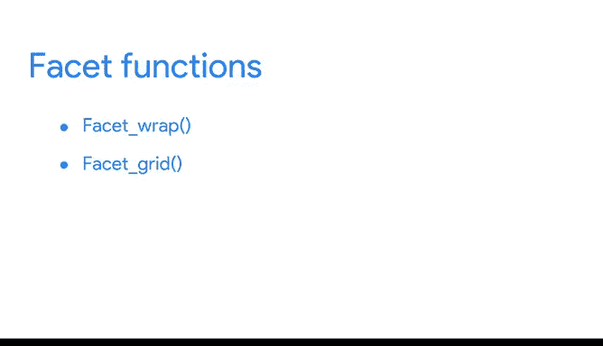
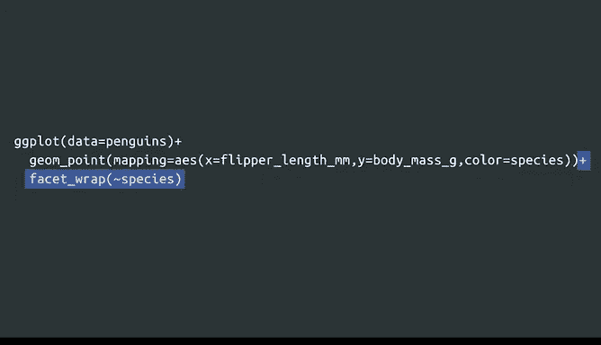
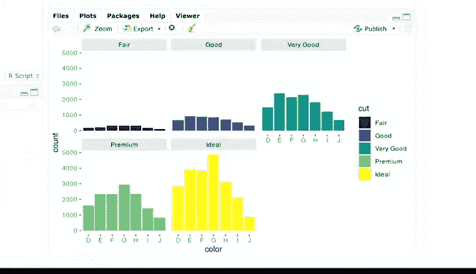
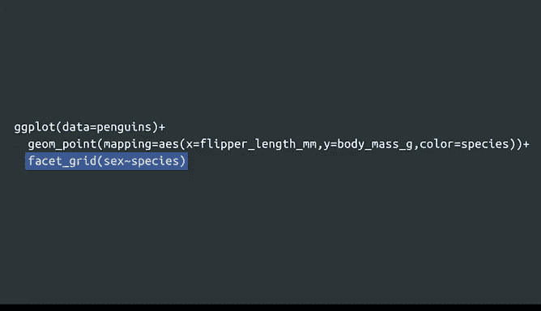
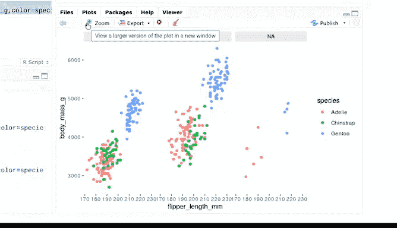

# 谷歌数据分析师第七课《使用R编程进行数据分析》data-analysis-r（中英双字） - P29：29_04_05_美学映射与分面系统.zh_en - GPT中英字幕课程资源 - BV1bg4y1P7AQ

Welcome back。 In this video， we'll learn how to use the G G plotot 2 facet functions to display our data in new ways。

😊，Facacet functions let you display smaller groups or subsets of your data。

A facets a or section of an object， like the sides of a gemstone。

Facets show different sides of your data by placing each subset on its own plot。

Fting can help you discover new patterns in your data and focus on relationships between different variables。

 For example， let's say you're looking at sales data for a clothing company。

You might want to break down your data by category to show specific trends。

Children's clothing versus adult clothing or spring fashions versus fall fashions。

 Or if you are running an employee engagement survey。

 you might want to break down your data by tenure and compare senior employees to new employees。

 D G P 2 has two functions for fasting。Facet underscore wrap and facet underscore grid。

 Let's explore them both。 We'll start with facet， underscore wrap。

To facet your plot by a single variable， use facet underscore wrap。

Let's say we wanted to focus on the data for each species of penguin。

Take our plot that shows the relationship between body mass and flipper length in each penguin species。

The facet underscore wrap function lets us create a separate plot for each species。

To add a new layer to our plot， we'll add a plus symbol to our code。

Then inside the parentheses of the facet underscore rap function。Type a tilda symbol。

 followed by the name of the variable。

Let's log into our studio cloud and check it out As a reminder。

 we'll start by loading the G G Pot 2 package and the penguins data set。

You can find the Tilda symbol in the upper left corner of the Gu keyboardboard just below the escape key。

There， the separate plots show the relationship between body mass and flipper length within each species of penguin。

 Pretty cool， right。😊，Fts help us focus on important parts of our data that we might not notice in a single plot。

If your visual is too busy， for example， if it's got too many variables or levels within variables。

 faceting can be a good option。Let's try faceting the Dds data set。Earlier。

 we made a bar chart that showed the number of diamonds for each category of cut。Fair， good。

 very good， premium and ideal。We can use facet underscore wrap on the cut variable to create a separate plot for each category of cut。

 Let's check it out。

To facet your plot with two variables， use the facet underscore grid function。

Facet underscore grid will split the plot into facets vertically by the values of the first variable and horizontally by the values of the second variable。

For example， we can take our penguins plot and use facet underscore grid with the two variables。

 sex and species。In the parentheses， following the facet underscore grid function， we write sex。

 then the tilda symbol， then species。 Let's run the code。

There are 9 separate plots， each based on a combination of the three species of penguin and three categories of sex。

Facet underscore grid lets you quickly reorganize and display complex data。

And makes it easier to spot relationships between different groups。If we want。

 we can focus our plot on only one of the two variables。 For example。

 we can tell R to remove sex from the vertical dimension of the plot and just show species。

 Let's check it out。You can easily spot differences in the relationship between flipper length and body mass between the three species。

In the same way， we can focus our plot on sex instead of species。

Facets let you reorganize your data to show specific relationships between variables and reveal important patterns and trends in subsets of your data。

 That's all for now。 Next up， we'll learn how to customize our plots using labels and annotations until next time。

