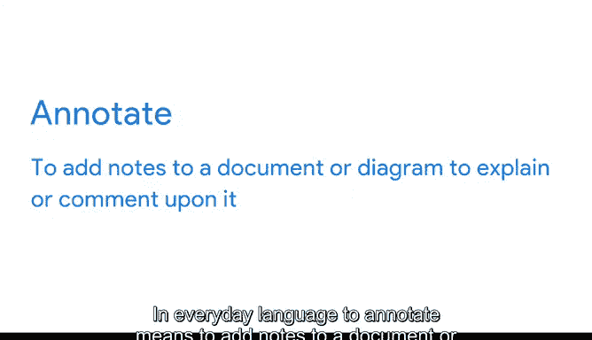
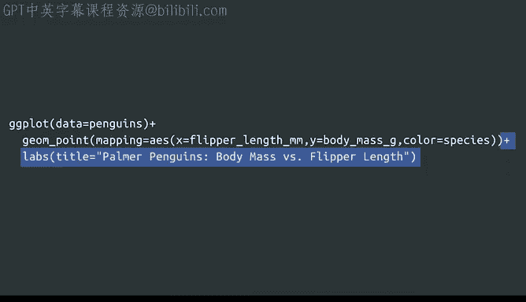
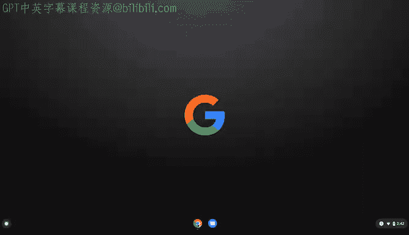
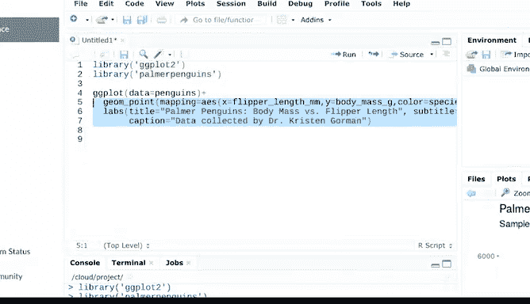
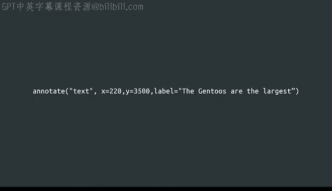
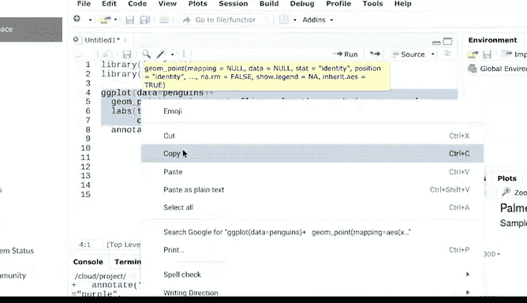

# 谷歌数据分析师第七课《使用R编程进行数据分析》data-analysis-r（中英双字） - P30：30_04_01_注释图层详解.zh_en - GPT中英字幕课程资源 - BV1bg4y1P7AQ

Hi， great to have you back。 Coming up， We'll learn how to customize the look and feel of our plots using the label and annotate functions。

😊，In everyday language， to annotate means to add notes to a document or diagram to explain or comment upon it。

In GG plot2， adding annotations to your plot can help explain the plot's purpose or highlight important data。

When you present your data of visuals to stakeholders， you may not have much time to meet with them。

Labels and annotations will point their attention to key things and help them quickly understand your plot。

Let's start with the label function。 It's super useful for adding informative labels to a plot。

 such as titles， subtitles and captions。 For example。

 we can add a title to our plot that shows the relationship between body mass and flipper length for the three penguin species。

😊，A title will clearly indicate the purpose of the plot。Let's go over the code。First。

 we add a plus sign to add a new layer to our plot。Next。

 in the parentheses following the label function， we write the word title， then an equal sign。

 then the specific text we want in our title。

Let's log into our Studio cloud and check it out。 First。

 let's load the G G Ploot2 package and the penguins data set。

Remember， put the plus sign at the end of a line of code， it's easy to forget。

R automatically displays the title at the top of the plot。

We can also add a subtitle to our plot to highlight important information about our data。To do this。

 we enter the code for a subtitle in the same way as a title。

Remember to add a comma after the title argument before you enter your subtitle。

R automatically displays the subtitle just below the title。We can add a caption to our plot。

 in the same way。Cptions let us show the source of our data。

The Palmer Penguins data was collected from 2007 to 2009 by Doctor Kristen Gorman。

 a member of the Palmer Station Long term Ecological Research Program。Let's cite Dr。

 Gorman in our caption。

R automatically displays the caption at the bottom right of our plot。Titles。

 subtitles and captions are labels that we put outside of the grid of our plot to indicate important information。

If we want to put text inside the grid to call out specific data points。

 we can use the annotate function。For example， let's say we want to highlight the data from the Gen2 penguins。

 We can use the annotate function to add some text next to the data points that refer to the Gen2s。

This text will clearly communicate what the plot shows and reinforce an important part of our data。

Okay， let's check out the code。In the parentheses of the annotate function。

 we've got information on the type of label， the specific location of the label。

And the context of the label。In this case， we want to write a text label。

We also want to place it near the Gen2 data points。Let's put it at the following coordinates。

X axis equals 220 mm， and Y axis equals 3500 G。Finally， let's write our text。

 The Gens are the largest。😊，Let's run it。Check it out。

 Our automatically places the text label on the correct coordinates in our plot。😊。

We can customize our annotation even more。 Let's say we want to change the color of our text。Well。

 we can add color equals， followed by the name of the color。 Let's dry purple。

 We can also change the font style and size of our text。Use font face and size to write the code。

Let's bold our text and make it a little larger。We can even change the angle of our text。

 For example， we can tilt our text at a 25 degree angle to line it up with our data points。

 Let's try it。That looks great。By this point， our code is getting pretty long。

If you want to use less code， you can store your plot as a variable in R。As a quick reminder。

 to create a variable in R， you type the variable name then a less than sign followed by a dash。

 Let's try it with the variable name P。

Now， instead of writing all the code again， we can just call P and add an annotation to it like this。

You get the same result。Some people like to see every step of their code listed out in front of them。

 So there are advantages to doing it the longer way。 It's really up to you。

 I just want you to know that。 you've got options。Hopefully。

 this gives you an idea of some of the ways you can customize your plots。

 labelbels and annotations can be really helpful when it comes to highlighting important parts of your data than communicating key points。

😊，That's all for now， coming up， you'll learn some useful ways to save your plots in Gigi plot2。

See you next time。

