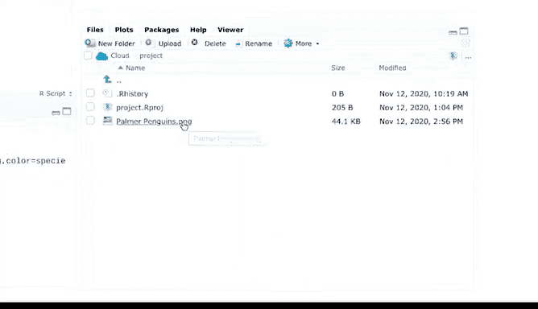
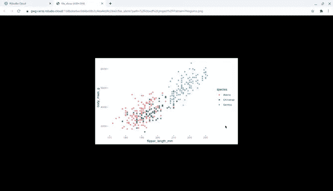
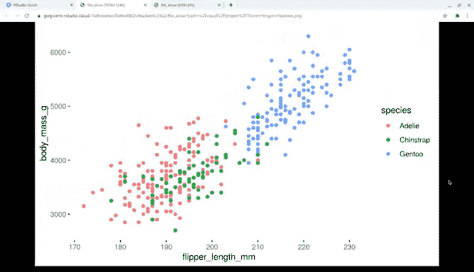

# 谷歌数据分析师第七课《使用R编程进行数据分析》data-analysis-r（中英双字） - P31：31_04_03_可视化作品保存方法.zh_en - GPT中英字幕课程资源 - BV1bg4y1P7AQ

Hi and welcome back。In this video， we'll learn how to save our plots。

 savingaving your work so that you can access it later is so important。

 it lets you continue to work on it yourself or share it with others。😊。

Being able to reproduce and share your work is a key part of your future analyst role。

 because it lets you collaborate with teammates。 They can double check your work and offer feedback to help you improve it。

 So let's save our plots to do this， you'll use the export option in the plots tab of our studio or the G G save function provided by the G G P2 package。

😊，First， we'll save our plots using the export option。Then we'll use the G G save function。

Let's log into our studio cloud。 We'll load the G G Pot 2 package and the penguins data set。To start。

 let's write some code and create the plot that shows the relationship between body mass and flipper length in three penguin species。

Let's use the export option in the plots tab to save our plot。

We can save it as an image file or a PF file。 Let's try saving it as an image。

There are six different options for image format， including PNG and JPE G。 Let's try PNG。Next。

 we name our file and click Save。Now， if we click on the files tab， we'll find our file in the list。

Let's open it up。Looks great。

That covers the export option for saving a plot。Now， let's check out the GG save function。

G G saves a useful function for saving a plot。 It defaults to saving the last plot that you displayed and uses the size of the current graphics device。

😊，Let's try saving our plot as a PNG file using GGSave。

Dchi save will automatically save the plot that shows the relationship between body mass and flipper length。

 because this is the last plot that we displayed。We have to give the file a name and say what kind of file we want to save it as。

Let's write the code。Within the parentheses of the function， we start off with a quotation mark。

 followed by the name of the file。Let's name it， Three penguin species。

We put a period after the file name， then the type of file we want， then a closing quotation mark。

Let's run it。Now， if we click on the Fi tab， we'll find our new file in the list。 Let's open it up。

Again， looks great。

That covers the basics of saving plots。 After all your hard work， creating plots and G G plot， too。

 youd definitely want to remember to save them so you can access and share them later on。😊。

And that's the end of our work on data visualization。 You're off to a great start。

 visualizing data with Gi G Bot 2。Plus， the concept we've covered are a great base for learning even more about Data and R as you move forward。

We started off by learning the basic steps for creating plots in G G Pot 2。From there。

 we learned how aesthetics can change the look of our plots and highlight important parts of our data。

We use different geos to create different types of plots， like scatter plots and bar charts。

 and used facet functions to show subsets of our data。

Then we customized our plots with labels and annotations。Finally。

 we learned how to save all our hard work so we can access and share it later on。

That's a lot of ground we covered。Feel free to review the videos any time you want and move at your own pace。

 It takes lots of time and practice to become familiar with new concepts and to develop new skills。

 No one gets everything right the first time around。 But the more you practice。

 the more you'll start to feel at home in Gi G plot， too。😊，If it doesn't always feel easy。

 that's okay。That just means your mind is expanding and your skill sets getting bigger。 Trust me。

 It's worth it。Learning G G P 2s a game changer for anyone interested in visualizing data。

 I hope you enjoyed it as much as I did。 I love creating visuals in Gi G P 2。😊，Coming up。

 you'll learn how to document and report your data using R until next time。

