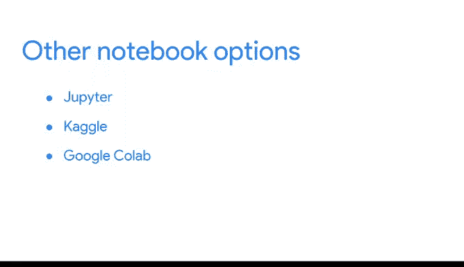

# 谷歌数据分析师第七课《使用R编程进行数据分析》data-analysis-r（中英双字） - P33：33_05_02_R Markdown概览.zh_en - GPT中英字幕课程资源 - BV1bg4y1P7AQ

Hi again， as a data analyst， you'll need to refer to your analysis at a moment's notice。

You might need to share it with your fellow team members。

 or a stakeholder might ask about one of your conclusions。

Documenting your work makes it easy to quickly share your analysis with anyone。

And that's where our markdown comes in。Earlier， we learned that R Markdown is a file format for making dynamic documents with R。

Our markdown lets you create a record of your analysis and conclusions in a document。

It ties together your code and your report， so you can share every step of your analysis。

And the best part is you don't even have to leave our studio to do this。

This document will help stakeholders and team members understand what you did in your analysis to reach your conclusions。

Their feedback will also help you improve your analysis。

Our markdown documents are written in Markdown。Markdown is a syntax for formatting plain text files。

Using markdown makes it easier to write and format text in your document。

Markdown is also easy to read and to learn。For example。

 if you want to italicize a word or phrase in markdown。

 just add a single underscore or asterisk right before and after the word。

When you create a report of the document， the mark down formattings no longer visible。

 Just the word or phrase in italics will show you more formatting options soon。

But they're all similar to this example。 Basically。

 they're simple enough to let you focus on descriptions and explanations of your analysis without having to think too much about how to format them。

 Besidess text， R markdown also includes an interactive option called an R note that lets users run your code and show the graphs and charts that visualize the code。

Any R markdown document can be used as a notebook。This creates a clear overall picture of your analysis and conclusions。

Our markdown lets you convert your files into lots of different formats， too。You can create HTML。

 PDF， and Word documents， or you can convert to a slide presentation or dashboard。

Having these options makes it easy to share the same analysis in a variety of ways。

 depending on your audience。The markdown language was originally designed for HTML output。

H TM L is the set of markup symbols and codes used to create a web page。

Our markdown has the most available features for this format。

But you can get good results in any of the formats。

While our markdown is a great way to record and share your analysis， there are other options too。

Notbooks like Jupiter， Cagggel and Google Coabab do a lot of the same things as an R markeddown notebook。

 including the interactive elements。

You'll read more about these options in a little bit。Coming up， we'll create an R mark down document。

 You'll get to see this effective analysis tool in action。 See you soon。

