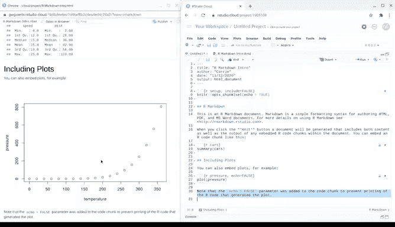

# 谷歌数据分析师第七课《使用R编程进行数据分析》data-analysis-r（中英双字） - P34：34_05_05_RStudio中的R Markdown应用.zh_en - GPT中英字幕课程资源 - BV1bg4y1P7AQ

Welcome back。Exploring the different tools available for analysis is one of the more fun parts of being a data analyst。

 By now， you've had the chance to try out tools like spreadsheets。

 Big query or other SequL tools and tableableau。😊，Now。

 we'll check out a tool you can use in R studio， R markdown。As a reminder。

 our markdown is a great tool for documenting your analysis at any stage。

 but especially when you've completed a project， Let's open up our studio and get started with our markdown。

😊，Feel free to follow along with the video and try it out on your own later。

Or go ahead and join us now in your own our studio account。

We'll first install the R markdown package by using our install packages function and R markdown in parentheses。

As a reminder， installing packages can take some time。

Bright red text may show up in your console as it installs。 That's all perfectly normal。Okay。

 let's open up a new R markdown or RMD file using the file menu。

If you're working along with us and you're prompted to do install packages that you'll need to open your file。

 go ahead and click yes。Right away， you might notice some of the outputs available in our markdown。

For now， we'll use the default HTML and document options。

The other output options will also be available later。

We'll add a file name and author and then open our file。Next， will save it so we can use it later。

So now we have an RMD file filled with metadata at the top and chunks of code in the gray sections。

There's text in between for explaining the code and adding comments on your analysis and conclusions。

This are markeddown documents in its original format。

It's definitely useful and can be edited and added to。

 but if we want to produce a report containing all text， code and results。

 we need to click the knit button。Now we've got the report。

It's an HTML file that you can share with others。Let's compare the original dot r m d file with the h t m l report。

You can tell that the text has been transformed into a more viewer friendly format。Also。

 the code chunks have all been run， and we now have their output。

 Both the columns of data and the plot from an analysis on the cars data set。

The report's clear and formatted in a way that's easy to follow and understand。

 We could share it with stakeholders， even if they've got no experience in R。

Our markdown files are definitely an effective way to complete the data analysis process。

You can start your analysis in R and create a report complete with code and visualizations all in the same workspace。

 Coming up， we'll show you more examples of how to use R markdown to make your documentation even more effective by for now。

