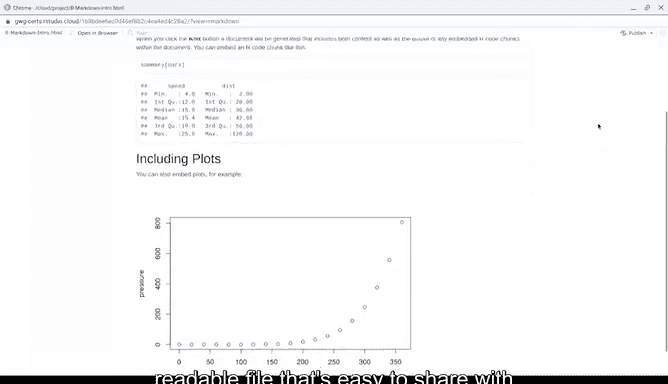

# 谷歌数据分析师第七课《使用R编程进行数据分析》data-analysis-r（中英双字） - P35：35_05_01_Markdown文档结构解析.zh_en - GPT中英字幕课程资源 - BV1bg4y1P7AQ

Hello there。Earlier， we showed you how to get started using R markdown。

We created a markdown document called an RMD file， which is super useful for making and saving a final report that summarizes your data exploration and analysis findings。

 in this video， we'll check out the structure of the text in an RMD file and how you could format it to better organize and emphasize your findings。

😊，Let's go into our studio and open the file we saved earlier called R Markdown Intro。

If you're working along with us and don't have a file saved。

 you can open up a new R Markdown or RMD file using the file menu。

If you're prompted to install packages， go ahead and click yes。

 click O to open with the default options and then save your file。Now。

 let's dig deeper into this file。 We'll start at the top。This is the yamel header section。

Yamel is a language for data that translates it， so it's readable。Fun fact。

 Yamel originally stood for yet another mark up language。

This section is called out using three dashes on the first and last lines。

This syntax automatically creates the Yaml header section when it's used in an RMD file。

In an RMD file， this sections basically for metadata or the data about the data in the rest of the file。

The title， author， date and file type of an output are automatically included when you create a new file。

 There's lots of different functions and formatting options in this section。For now。

 just make sure you have at least the four details we've got in our file now。

You can use the template that appears when you open the file and just edit over it。

Or you can start from scratch using the three dashes to create the Yaml section and the rest of the content in the file。

We'll cover these steps over the next few videos and in the other program resources。Next。

 let's check out the text in the white areas of our file。

Think of the text as a way to comment on and explain your code and analysis and any visualizations you're including。

You can format the text to include links， ordered lists， equations， and more。

The text is formatted using markdown。 the syntax we introduced earlier。

We've included a reading that shows you all of the ways to format text。

 as well as lots of other great markdown tips and tricks。

You'll also learn some more formatting examples in the next video。For now。

 let's try some examples that are in this file。On line 12。

 there's two hashtags and a space before the words are marked down。Hashtags are used for headers。

 The more hashtags， the smaller the header。The space is important as well。 Otherwise。

 our studio won't recognize that this is a header。Let's knit our file again。

There's the r markdown header in the htm L file。If we add two more hashtags in the dot RMD file and click knit once again。

 the output changes。The header is now smaller。We'll change it back because the original format made sense。

Since this header is introducing information about our markdown that comes in the next two paragraphs。

 we want to emphasize it。In the first paragraph of this section， there's a brief summary of markdown。

There's a link in the text， and it's formatted using angle brackets。

Using these brackets results in a clickable link in the output。

That's a handy feature if you want to refer to any helpful links or include them as sources for your analysis。

In the next paragraph， knit is set off with two asterisks on either side of the word。

This bolds the word。Using one asterisk on either side would instead italicize the word。

Let's scroll down to the last paragraph。Here we've got some inline code。

 which can be inserted directly into the text of a dot RMD file。The code appears in a gray box。

 like the code chunks we'll talk about soon。Using inline code like this lets you refer to the code directly as you explain it。

Let's knit our file one more time。All the formatting works together to make a well designed。

 readable file that's easy to share with stakeholders and team members。😊。

That's it for now。 But there's lots more to learn about creating your own reports。 Stay tuned。

