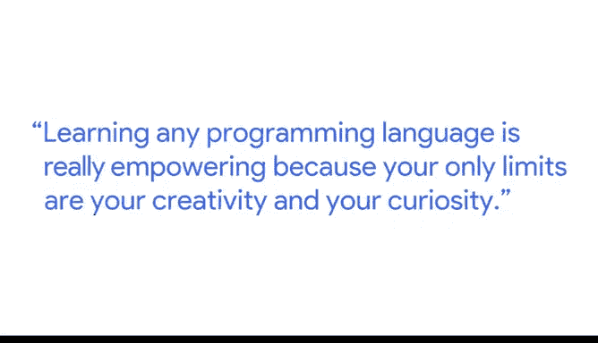

# 谷歌数据分析师第七课《使用R编程进行数据分析》data-analysis-r（中英双字） - P36：36_05_02_Meg_编程赋能之路.zh_en - GPT中英字幕课程资源 - BV1bg4y1P7AQ

I'm Meg and I'm a product lead at Google， as a product lead。

 I work with designers and web developers to build features that our users will love。

 specifically I work for CAL， which is an online data science community for people who are learning data science and machine learning。

So we get to build exciting features that help people learn from data and advance in their careers I work with designers and researchers to do studies to understand what our users want and what they need in the product。

And I work with engineers to figure out exactly how to write out those requirements for the features that we decide to build。

 learning any programming language is really empowering because your only limits are your creativity and your curiosity。

It's really the curiosity that I have about the world that led me to research and data analysis。

 especially with R， just felt it was really freeing to be able to ask a question about the world and know how I could work with data to get an answer to that question。

The second thing that I think is really exciting and empowering about knowing a programming language is the transferable skills that it gives you and then the last thing I think is really exciting is really the like community and ecosystem that comes along with it our is really no exception when it comes to that in fact I think ours community is really outstanding and to have the community and that public ecosystem of resources right at your fingertips is really going to supercharge what you can do with data as a data analyst and I think that's super exciting。

 it's completely normal to feel intimidated or confused or kind of stuck is your first learning R。

There are things that are kind of quirky about the language and you know it's not your fault you know you just kind of have to get past those things and I can promise that things will make a lot more sense。

 especially once you're able to start using the tidy verse I would say you know stick with it and the other you know kind of piece of advice I'd have is try to connect with the R community as early as possible in your R learning journey the thing that's just fantastic about R is the fact that its community is really vibrant。

 it's really welcoming and you're going to find things like people who are expert practitioners in R who are you know sharing their kind of like their mistakes and they'll they're willing to share their kind of like learning journey as well and I think it'll really help you see that you know。

You're not alone， I definitely had these moments where I was pretty frustrated when I was first learning R when it really clicked for me was when I had the opportunity to use R to answer my own personal research questions。

 that is when you feel like you have a personal vested interest in the outcome of your analysis。

 that feeling of like reward and satisfaction when you push through is you know something that can help you really build that like momentum to keep learning。

