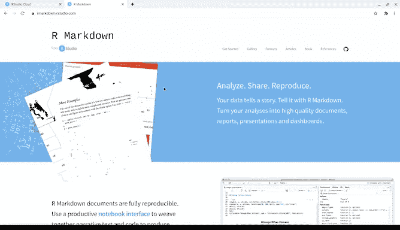

# 谷歌数据分析师第七课《使用R编程进行数据分析》data-analysis-r（中英双字） - P37：37_05_03_高级文档元素应用.zh_en - GPT中英字幕课程资源 - BV1bg4y1P7AQ

Great to see you again。 As we've explored our markdown。

 we've learned how the interactive elements work。😊，When you change something in your RMD file。

 our studio automatically applies it to your report。 in this video。

 we'll show you a few more formatting options for making your report more complete and dynamic。

Let's go back once again to our dot RMD file called R Markdown Intro。We'll make some edits。

 add some elements， and then convert it to an H document。We'll start by adding bullets。

Just like in a standard document， bullets can help you organize your content。In our file。

 we'll turn the list of the documents that our markdown can author into bullet points。

We use asterisks in the dot RMD file to create the bullets in the output document。

Will revise this section so that the bullet points are set up in the right way。

Now let's check out a different way to include a link in the file。When you're writing a report。

 you might want a link to the company website or to pages you used for research。Right now。

 in the first paragraph， we have the website URL inside of angle brackets。

To embed the link in text instead， let's change the formatting。

We'll start by changing the text to better fit the embedded link。

Then we'll add square brackets and the word we want to embed the Lincoln。

And will change the angle brackets around the URL to parentheses。Both types of links were great。

 but some URLs are long and might clutter your report。In those cases。

 embedding links save space and can look cleaner。Let's say you want to embed an image， too。

Images are good for showing your workflow or displaying visualizations you want to reference in your report。

 Or maybe you just want to add a Gif or another fun image。😊，That's great。

 Just make sure your stakeholders will appreciate it。😊。

Let's go ahead and have some fun with this example。 We'll embed an image with the plot example。

Then we'll add an exclamation point and a caption for the image in square brackets。

Nextex we'll copy the URL for our image and paste it inside parentheses。

now let's check out our finished product。We'll view it in our browser that way。

 when we click the embedded link， it opens up in a new tab in the same browser。

Here's our bullet points， and our image and caption。And here's our embedded link。

 which we can click to open the website。And there's lots more ways to format an RMD file to get it ready to turn into a complete。

 organized and effective report。

While reports are a key part of presenting your analysis to stakeholders。

They can be just as important for your own learning。You can use dot RMD documents。

To keep track of your learning by including notes and linking to online resources。

 you can embed useful images and add bullet points， too。Speaking of learning。

 let's find out more about code chunks and RMD files in the next video。See呀。😊。

