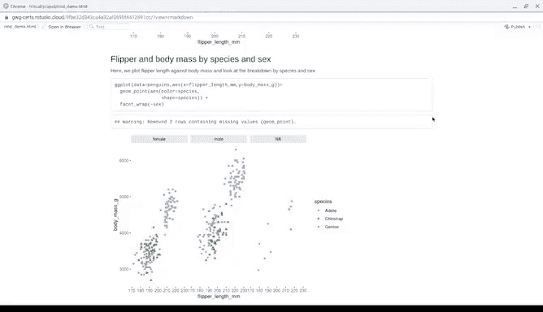

# 谷歌数据分析师第七课《使用R编程进行数据分析》data-analysis-r（中英双字） - P38：38_05_01_代码块使用指南.zh_en - GPT中英字幕课程资源 - BV1bg4y1P7AQ

Hi again， we've learned a lot about R markdown or R And D files and how they can be formatted and converted into reports for stakeholders。

We've also explored the Yaml header and the comments。

 descriptions and explanations for the analysis shown in the report。

Now comes the heart of an RMD file， the code。Code added to an RMD file is usually called a code chunk。

We've shown you these code chunks in some of the R studio sessions we've been running。

 and you may have noticed code chunks if you've been practicing along with us。Now。

 we'll show you what they're all about。Earlier， we worked with the Palmer Penguins dataset set。

 We ran some code to analyze the data and create visualizations。After this step。

 we'd probably want to set up a practice report with notes about our analysis。

We'll do that here and incorporate some code and visuals。

 Let's start by opening up our studio and then the script with our programming。

 the Gi G plot underscore hook file。We could share this file directly with others。

 but it's not very effective。 It's hard to read and doesn't always include any takeaways。

So we'll create a new dot RMD file instead。Well add a title and author。

Now we have two tabs in our script pane。We can toggle between them， just like with browser tabs。

Will'll save our new do RMD file。This file is in the template format。

 So we'll delete everything except the header section and start our own。

We already set up the header section， so we don't need to make any changes there。Instead of deleting。

 we could make edits section by section， adding our own comment and code along the way。

But deleting the file contents gives us a blank space to work in and helps us avoid potential errors from mixing our own comments and code with the pre existing ones in the template。

Before we add any code， we want to describe its purpose。

The first code chunk will set up our R environment by loading our packages using the library function。

So on a new line， we'll type two hashtags to format a header for this section。

 followed by the header text， setting up my environment。Then we'll add a note about the code。

We've added apostropphhees before and after tidy verse and Palmer penguins because they're the names of the packages。

 which makes them part of the actual code。And now， we'll add our code。

Our studio has a handy code menu that we can use to insert a code chunk。

There's also a button in our script pane that lets us add code chunks。

This creates a gray section in our file and chunk delimiters。

 A delimiter is a character that indicates the beginning or end of a data item。

 You could also type these delimiters directly in the file。3 Batics。

 followed by an R in braces to begin the code chunk and three batics to end it。

Or you could use the keyboard shortcuts control plus Alt plus I on a PC or Chromebook。

And command plus option plus I on a Mac。Since we're in our studio， the code menu works just fine。

Inside the first brace we'll label our code chunk。After the R。

 we'll add a space and then type loading packages。This adds another layer to our organization。

 We can now easily find this code chunk and its label using the contents menu at the bottom of our script pane。

😊，Next， between our delimiters， we'll add our first code chunk。

 which we use to load our two packages。Even if they're already loaded， loading them again。

 make sure that our packages will be updated to the latest version。We can type starting on the line。

 after the first delimiter。But since we also have our programming file available。

 we'll copy and paste from there。Now we can run our code right in the file to check it for errors。

And there's the code output。We can also change our code chunk options。

There's options for changing the output and for turning off warnings and messages。

 These are useful for when you're ready to create a final report for stakeholders。

You'll have control over what you'll show them in the report。For example。

 if you get warnings with your output that don't impact your findings。

 you can turn off the warnings for stakeholders。So the code chunks are the key to making this report a good learning tool and eventually a document worth presenting to stakeholders。

When you have code embedded in a file and can show its output。

 you can provide evidence for your findings and share your sources。

And if you need more evidence for how our mark down can help you document your analysis。

 We've got it coming next。 See you then。