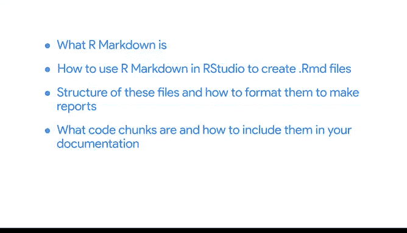

# 谷歌数据分析师第七课《使用R编程进行数据分析》data-analysis-r（中英双字） - P39：39_05_02_文档导出与发布.zh_en - GPT中英字幕课程资源 - BV1bg4y1P7AQ

Hi again。 one of the most powerful things about an R markdown file is that you can convert it to different output types to create shareable reports。

😊，We've been focusing on HTML documents， but there are other options we can explore。

Let's start by opening our earlier report。We created this report as a learning document to help you think through your code and analysis。

For this video， imagine it's a report you need to share with stakeholders。

The file is currently in the dot RMD format， but as we've shown。

 it can be converted using the knit button。The knit drop down menu includes three main options， H， P。

 and a Word document。You can use knit to convert your file to any of these types whenever you want。

 but it's good practice to wait to convert to a Pf or Word doc。Instead。

 stick with HTML while you're working。HtML doesn't have page breaks。

 so you can focus on generating content for your report and not its appearance。

The knit button isn't the only option for converting your file。

The YaAmL can be edited to change your metadata or incorporate more details。For example。

 we'll change our output in this file to PDF。When we click the knit button to render the file and run the code。

 the outputs in a PDF format。So you know how changing the metadata can have an effect on the whole report。

And if you need to create a certain type of document over and over。

 or if you want to customize the appearance of your final report， you can create a template。

If it's a monthly or annual report that you're creating for stakeholders。

 you can just run one line of code to update your data and your report's ready。

We won't cover creating a template here， but it's something you might want to learn more about on your own as you get more experience in R。

We've now explored a big part of our markdown and our documentation。

We've explained what our markdown is and how to use it in our studio to create dot RMD files。

We've checked out the structure of these files and how you can format them to make reports。

 We've shown you what code chunks are and how to include them in your documentation。

 And we've shown you how to take all of that analysis plus your explanation of that analysis and transform it from a dot RMD file into a report that you can use as a learning document or share with stakeholders。

It's a great way to wrap up the data analytics process in R and R studio。

 and it's nearly time for you to wrap things up in this program。

But if you want to review any concepts or practice some more in our studio。

 feel free to rewatch the videos any time for some extra help。 See you soon。

