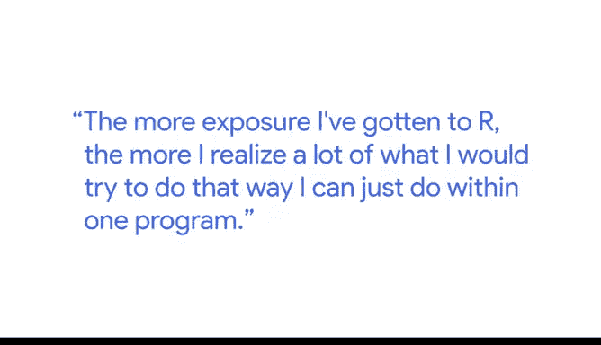
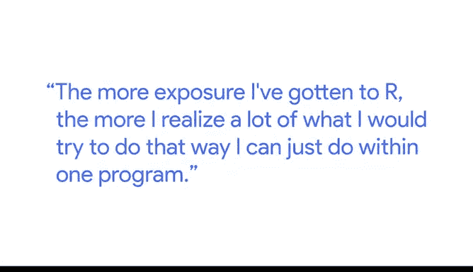

# 谷歌数据分析师第七课《使用R编程进行数据分析》data-analysis-r（中英双字） - P3：03_01_07_Carrie的R语言入门指南.zh_en - GPT中英字幕课程资源 - BV1bg4y1P7AQ

The advice I would give to someone just learning R is that。Mistakes are part of the process。

 errorsors and error messages are part of the process。

 When I think about the people who are even better than I am and are。

I think I've come to realize they're not necessarily smarter than I am。

 but they may be a little bit more persistent and delving a little bit deeper。

 And certainly compared to when I started， I think initially， I'd see an error message and think。

 I did a wrong like， oh， you know， game over。And now it's like， oh， that's just part of the game。

 When I started to get a little bit of exposure to what R looked like， I was like， oh。

 that seems too sophisticated。 It seems like it probably is really， really hard。

But the people who used it that I had met were always really enthusiastic about it。

 And they felt like it had so many advantages over other software that you can use for running analyses。

 There were a lot of times before I used R where I might use spreadsheets or some other tool。

 And I would kind of be trying to hack at what really needed to happen。

 Sometimes I was using multiple tools because an individual tool couldn't really do all of what I wanted it to do。

 but it's sort of like I knew in my mind。😊，And yet， it wasn't totally fluid。 The execution of it。

 The more exposure I've gotten to R， the more I realize a lot of what I would try to do that way。

 I can just do within one programme。

And it can all sort of interlock really fluidly。 At first， I was。Really uncondent I。

Had a couple of scripts where I had some friends who were better at R， people I worked with。

 who would sit down and sort of like help me go through and understand the code。

 And so it felt like really silly to ask them the kind of like simple question of like， okay。

 but why is a bracket here or why would we do this。But they were fortunately really patient people。

 and then at some point， our entire department said， actually。

 really everybody needs to be using this because we need everyone on the same platform。

 we need consistency in our analyses。 We need to be able to code review each other's analyses as well。

And so we all took an online course together。 And that actually helped me feel really a lot more confident because it was walking through each step of what you needed to know。

 got an opportunity to practice。 and you know， then it felt like， okay， you know。

 even even if there's things I don't know。 I've made it through introduction。

 Like I've made it through this next module。 So I guess I do know something。

 And then once I started to apply it in my work。 there would still be points where I was like， wait。

😊，I don't know。 I don't know how to solve this problem。 And then I would talk to a friend， you know。

 Google something。 And generally， it was like， I knew a lot more than than I thought that I did。

 And from that， I suddenly。Unlocked my ability to produce a whole lot of analyses quickly with the big data set and also produce a whole lot of data visualizations really quickly using G G P2。

 Hi， my name is Carrie， and Im a research manager within people operations at Google。😊。

