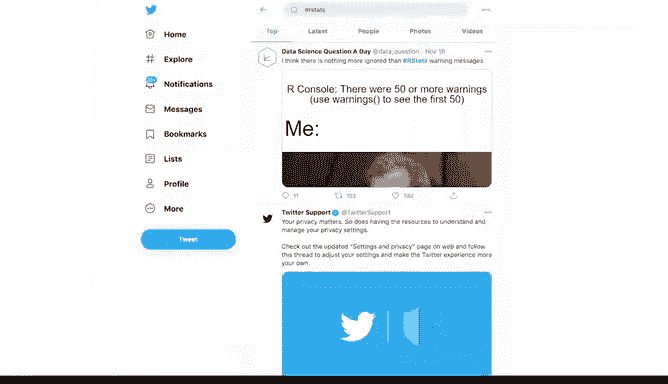

# 谷歌数据分析师第七课《使用R编程进行数据分析》data-analysis-r（中英双字） - P5：05_01_04_R语言简介.zh_en - GPT中英字幕课程资源 - BV1bg4y1P7AQ

Hello again， now that we've talked about programming languages in general， let's get to know R。

So what is R R is a programming language frequently used for statistical analysis。

 visualization and other data analysis。 Later on you'll take a tour of R studio。

 which is a popular software environment for the R language In this video。

 we'll discuss R's main features and functions and its advantages for data analysis。

Our is super cool， I'm excited for you to learn about it。

R is based on another programming language named S。In the 1970s。

 John Chambers created us for internal use at Bell Labs， a famous scientific research facility。

In the 1990s， Ross Ihaka and Robert Gentleman developed R at the University of Auckland， New Zealand。

 The title R refers to the first names of its two authors and plays on a single letter title of its predecessor。

 S。Since then， ours become a preferred programming language of scientists。

 Statisticians and data analysts around the world。 There's lots of reasons why people who work with data love R。

I want to share four with you。As accessible， data centric， open source。

 and has an active community of users。First。Our is an accessible language for beginners。

Lots of people without a traditional programming language learn are。 I should know。 I'm one of them。

Are really appeals to anyone who wants to solve problems that involve data。

 And that's one of the things that's so great about R。 It's all about data。

R is what's known as a data centric programming language。

 It's specifically designed to make data analysis easier， more efficient and more powerful。

 Another awesome thing about R is that it's open source。

 Open source means that the codes freely available and may be modified and shared by the people who use it。

😊，Let's pause for a moment and unpack how amazing this is。 First， anyone can use R for free。 Second。

 anyone can modify the code， fix bugs and improve it。 In fact， over the years。

 lots of excellent programmers have made improvements and fixes to the R code。😊，For example。

 anyone who knows the R language can create what's called an add on package。

 We'll talk more about our packages later For now， just know that literally thousands of R packages exist。

 and they were all built by people who wanted to solve specific problems。

A lot of these packages are super useful for data analysts。As an R user。

 you now enjoy the benefit of this shared knowledge。And let me just add the R community is the best。

 This vibrant， diverse and accessible community is so supportive of new learners。

 You can go online any time to find answers to all your R questions。

 Check out websites like R for data science On learning community and our studio community。

 On top of that， our users are all over Twitter and other social media。😊。

You'll discover tons of resources for professional networking， mentoring， and learning。

Now that we know more about the general benefits of R。

 let's talk about some specific situations when you might use it for data analysis。

 here's three scenarios。Reproducing your analysis。Processing lots of data。

And creating data visualizations。First， A can save and reproduce every step of your analysis Earl。

 we discussed how data analysis is most useful when you can easily reproduce your work and share it with others。

In R， reproducing your analysis is as easy as pressing a button on your keyboard。

Your code stores it forever， And you can share it with anyone at any time。

 Prosing lots of data is also something R does really well， just like SQL。As you learned earlier。

 spreadsheets organized projects in sheets or tabs。

If you've ever had to deal with spreadsheet files that have tons of sheets or lots of data in each sheet。

You know， that things can start to move very slowly。

Working with too much data in a spreadsheet can even cause crashes。

A can handle large amounts of data much more quickly and efficiently。Finally。

 art can create powerful visuals and has state of the art graphic capabilities。😊。

As you've seen in this program， tools like spreadsheets and Tableau offer lots of options for visualizing your data。

Ours on another level with only a small bit of code， you can create histograms， scatter plots。

 line plots， and so much more。 And that's just the beginning。If you work with more advanced packages。

 you can make some seriously impressive data visualizations。

Learning Rs a huge benefit to anyone interested in becoming a data analyst。As I mentioned earlier。

 knowledge of R will help you stand out as a job candidate。And as you keep moving forward。

 R will help you find solutions for more complex data problems。

You can keep learning about R throughout your career as a data analyst。

The sky's the limit when it comes to developing your data analysis skills。 That's all for now。

 Coming up， We'll check out the R studio environment together。Before you use our studio。

 you need to download and install the basic R interface。

 You'll learn how to do them in an upcoming reading。

Most analysts who work with the R language use the R studio environment to interact with R and not the basic interface。

That's why we're focusing on our studio in this program。Following this video。

 you'll find resources for downloading R and our studio if you're interested in learning more bye for now。

