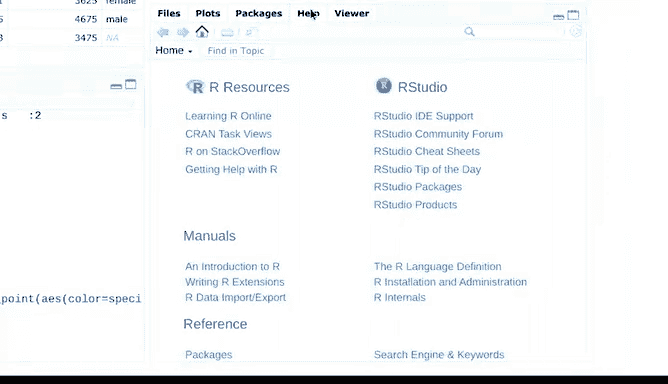

# 谷歌数据分析师第七课《使用R编程进行数据分析》data-analysis-r（中英双字） - P6：06_01_01_RStudio入门指南.zh_en - GPT中英字幕课程资源 - BV1bg4y1P7AQ

Hey there， it's time to take our tour of our studio。

 the examples we look at are from our studio cloud。

 but our studio works in a similar way across all platforms feel free to use the platform that works best for you。

Later on， if you want to learn more， you'll find resources on how to download and install R studio on your own device。

 R studios an I D E or integrated development environment。

 This means that our studio brings together all the tools you might want to use in a single place。

 The R console， which we explored earlier， is one part of this environment。😊。

Our studio also includes an editor for writing code and tools for managing your data and creating visuals。

Our studio is built specifically for use with R。 It'll help maximize your productivity as a data analyst。

 Data analysis is like driving a car。You can think of R and R studio as different parts of this car。

Ours like the car engine。 Our studio is kind of like the accelerator。

 the steering wheel and dashboard all in one。It lets you tell the engine what to do and helps you get to where you want to go。

Just as a speedometer and navigation system makes driving much easier。

 our studio's environment makes using R much easier。 In an earlier reading。

 you learned how to access our studio。 So let's log into our studio now and explore the R studio environment has four main windows called panes。

😊，Each pain helps you perform different functions。The first time you open our studio。

 you'll see three panes。 A fourth pane is hidden by default， but it's easy to open。

 Just click on file in the menu， then select new file and R script。

Our studio has lots of keyboard shortcuts to learn more。 check out keyboard shortcuts Help。

You can make the panes smaller or larger by clicking on the minimize or maximize buttons at the upper right of each pane。

You can also click and drag the borders of the panes to adjust their size。

Click on the paints button for more feature options。Now that we've got all four panes open。

 let's explore each of them。We'll start on the lower left and move clockwise from there。

You might recognize the R console from an earlier reading as a quick refresher。

 the console is the place where you give commands to R。For example。

 we can tell R to show us a summary of the penguins data that we used in an earlier video to create visuals。

You'll need to install and load the Palmer Penguins data set if you haven't done so already。

Above the console in the upper left is the source editor pane。

 You'll use the source editor when working with R scripts。

 There are two main ways of writing code in our studio， using the console or using the source editor。

 you can type commands directly into the console， but they'll be forgotten when you close your current session。

As we've discussed， it's important to be able to reproduce and share all the steps of your analysis if you save your script in the editor。

 you can access your work again at any time and show others how you did it。

The source editor and the console also work together in our studio。

When you execute code in the editor， the code automatically appears in the console。

If you're working on a long analysis， this makes it easy to execute the entire code all at once or run specific sections of it as you go along。

Let's run some code in the editor and check it out。Pro tip。

 always keep in mind that R is case sensitive here we use a capital V for the view function。Next。

 let's go to the En pane in the upper right。Here you'll find all the data you currently have loaded and can easily organize and save it。

For example， if you import data from a spreadsheet， it'll be visible in the environment pane。

You can view each object in the environment pane by clicking on it。

You can also toggle between a list view and a grid view。To the right of the En tab。

 you'll find the history tab。 All your previous commands are saved here。

 and they're easy to search and re execute。 You'll find the most recent line of code at the bottom of the list。

😊，You can copy any line to the command console by double clicking it。In the lower right。

 you'll see a pane that has tabs for files， plots， packages， and help。

The files tab gives you access to your file directory and shows the contents of the current working folder。

You can easily find and manage all your files and create new project folders。Next is the plots tab。

If we create a plot， the result appears here。For example。

 we can create a scatter plot with the penguins data set we used earlier。

You'll learn more about creating plots in our studio later on。Earlier， we talked about our packages。

 which are custom solutions to data problems developed by our users。

Our studio gives you access to a library of our packages known as the tidyverse。 you can upgrade。

 install and manage your library in the packages pane Packages loaded in your current session have a check mark。

Later on， we'll explore the tidy verse in more detail。Finally， click on the Help tab。

Here you can find helpful resources for our and our studio。

 There are tons of resources out there to help answer all your questions。

Be sure to take advantage of them。That's our tour of our studio。

 We're just scratching the surface of what our studio can do。 Soon。

 you'll get to explore our studio in more detail， speaking as a data professional。

 I love working in our studio。 It makes my work so much easier， faster and better。

 Congratulations on finishing another step in your data analyst learning journey。

 Com up will' learn some basic programming concepts。 Then we'll start working with R。😊。

For those of you who are new to programming， you're about to write your first lines of code。

 See you then。

