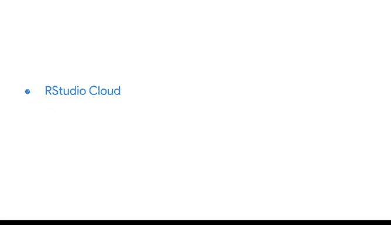

# 谷歌数据分析师第七课《使用R编程进行数据分析》data-analysis-r（中英双字） - P7：07_02_01_使用RStudio进行编程.zh_en - GPT中英字幕课程资源 - BV1bg4y1P7AQ

Hi and welcome back！We've given you a big picture overview of R and our studio。

Now we'll turn our focus to the actual programming and coding you'll do using our studio。

I went pretty far in my career not knowing programming， before it became clear， I needed to learn it。

Getting to know R was such a valuable learning experience。

 it took some time and I reached out to more experienced our users with lots of questions。

And eventually， it all came together for me。Being open to learning new skills is such an important part of your career。

And now I'm able to help you learn some new skills， too。

I'll start by sharing the fundamentals of programming using R in R studio。Earlier。

 we explained how our is like the engine of a car and our studios like the accelerator。

 steering wheel and dashboard all in one。Getting to know fundamentals will help you keep your R car running smoothly。

These fundamentals are both alike and different from the other analysis platforms you've come to know well。

 spreadsheets and SQL。 Then we'll move into coding in our studio。

We'll discuss the syntax for performing calculations and the standards and naming conventions for all code。

 We'll also explore the R tool known as a pipe。Which you'll use to make a sequence of code easier to work with and read。

Then will check out our packages。While these packages won't be delivered to your door。

 they are delivered by the R community。These packages contain reusable functions and more and are usually built by users for users like yourself。

 We'll get to know a collection of packages called the tidyverse。

 You'll learn how to install the tidyverse so you can start using it in our studio。😊。

We'll also work with some of the more popular tidyverse packages like Gi G P2 for visualization。

You'll be able to carry over what you've learned about our studio to the next part of the program。

Where you'll start working with data。As we explained earlier， for this program。

 we'll use the in browserrow version of ourSt， our Studio cloud。

But our studio is also available to be downloaded。

So let's get going， see you soon。