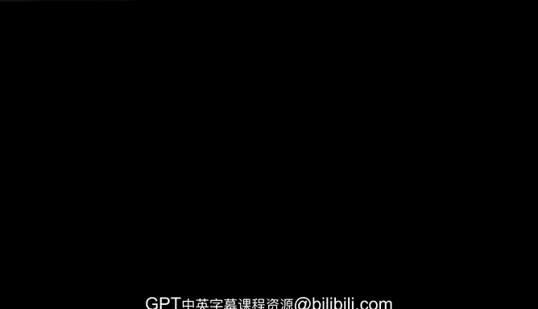
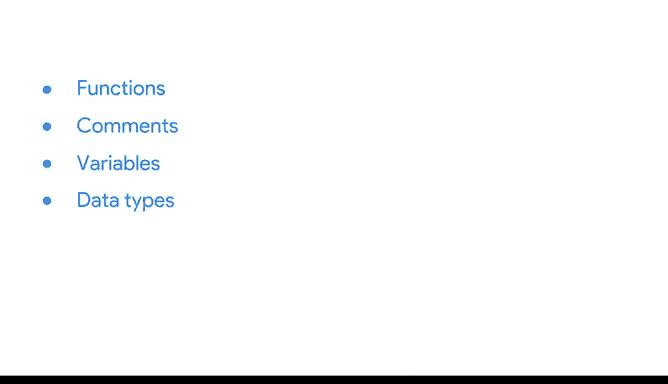

# 谷歌数据分析师第七课《使用R编程进行数据分析》data-analysis-r（中英双字） - P8：08_02_02_编程基础概念.zh_en - GPT中英字幕课程资源 - BV1bg4y1P7AQ

Hey there。Anytime you're learning a new skill from cooking to driving to dancing。

 you should always start with the fundamentals programming with R is no different。

To build this foundation， you'll get familiar with the basic concepts of R， including functions。

 comments， variables， data types， vectors， and pipes。Some of these terms might sound familiar。

For example， we've come across functions in spreadsheets and SQL。As a quick refresher。

 functions are a body of reusable code used to perform specific tasks in R。

Functions begin with function names like print or paste。

 and are usually followed by one or more arguments in parentheses。

An argument is information that a function in R needs in order to run。

Here's a simple function in action， feel free to join in and try it yourself in our studio using your cloud account。

Check out the reading for more details on how to get started。

You can pause the video anytime you need to。We'll open our studio Cloud to get started。

We'll start our function in the console with the function name， print。

 This function name will return whatever we include in the values in parentheses。

 We'll type an open parenthesis followed by a quotation mark。

 Both the closed parenthesis and end automatically pop up because our studio recognizes the syntax。

 Now， we just have to add the text string。Will type coding in R。Then we'll press enter。Success。

 the code returns the words coding in R。If you want to find out more about the print function or any function。

 all you have to do is type a question mark， the function name， and a set of parentheses。

This returns a page in the Help window， which helps you learn more about the functions you're working with。

Keep in mind that functions are k sensitive。 so typing print with a capital P brings back an error message。

Functions are great， but it can be pretty time consuming to type out lots of values To save time。

 we can use variables to represent the values。This lets us call out the values anytime we need to with just the variable。

Earlier， we learned about variables in SQL。A variable is a representation of a value in R that can be stored for use later during programming。

Varis can also be called objects。As a data analyst。

 you'll find variables are very useful when programming。For example。

 if you want to filter a data set， just assign a variable to the function you use to filter the data。

That way， all you have to do is use that variable to filter the data later。

When naming a variable in R， you can use a short phrase。 A variable name should start with a letter。

And can also contain numbers and underscores。So the variable5 penguin wouldn't work well because it starts with a number。

Also， just like functions， variable names are case sensitive。

Using all lowercase letters is good practice whenever possible。 Now。

 before we get to coding a variable， let's add a comment。

 Comments are helpful when you want to describe or explain what's going on in your code。

 Use them as much as possible so that you and everyone can understand the reasoning behind it。

Comment should be used to make an R script more readable。A comment shouldn't be treated as code。

 so we'll put a hashtag in front of it。 Then we'll add our comment。 Here's an example of a variable。

Now， let's go ahead with our example。 It makes sense to use a variable name to connect to what the variable is representing。

 So we'll type the variable name first， underscore variable。Then， after the variable name。

 we'll type a less than sign followed by a dash。This is the assignment operator。

 It assigns the value to the variable。 It looks like an arrow。

 which makes sense since its's pointing from the value to the variable。

There are other assignment operators that work too。

 but it's always good to stick with just one type in your code。Next。

 we'll add the value that our variable will represent。 We'll use the text。 This is my variable。

If we type the variable and hit run， it'll return the value that the variable represents。

 This is a very basic way of using a variable。 You'll learn more ways of using variables in your code。

 soon。For now， let's assign a variable to a different data type。Nummeric。

We'll name this second variable and type our assignment operator。We'll give it the numeric value 12。

5。The environment pane in the upper right part of our workspace now shows both of our variables and their values。

There are other data types in R， like logical， date， and date time。

R has a few options for dealing with these data types。 We'll explore them later。With functions。

 comments， variables and data types， you've got a good foundation for working with R。

 We'll revisit these throughout this program and show you how they're used in different ways during analysis。

 Let's finish up with two more fundamental concepts， vectors and pipes。😊，Simply put。

 a vector is a group of data elements of the same type stored in a sequence in R。

You can make a vector using the combined function。In R， this function is just the letter C。

 followed by the values you want in your vector inside parentheses。All right， let's create a vector。

 Imagine this vector is for a measurement data that we need to analyze。

We'll start our code with the variable V， E， C。Underscore one。To assign to the vector。

Then we'll type C and the open parenthesis。Then we'll type our list of numbers separated by commas。

We'll then close our parentheses and press En。This time， when we type our variable and press enter。

 it returns our vector。We can use this vector anywhere in our analysis with only its variable name。

 Vec_1。The values in the vector will automatically be applied to our analysis。

That brings us to the last of our fundamentals， pipes。

A pipe is a tool in R for expressing a sequence of multiple operations。

A pipe is represented by a percentage sign， followed by a greater than sign and another percentage sign。

It's used to apply the output of one function into another function。

Pipes can make your code easier to read and understand。 for example。

 this pipe filters and sorts the data。Later， we'll learn how each part of the pipe works。

So there they are the super 6 fundamentals， functions， commentss， variables， data types。

 vectors and pipes。 They all work together as a foundation for using R。 It's a lot to take in。

 So feel free to watch any of these videos again。 If you need a refresher。😊。

When you're ready， there's so much more to know about R and R studio。 So let's get to it。

