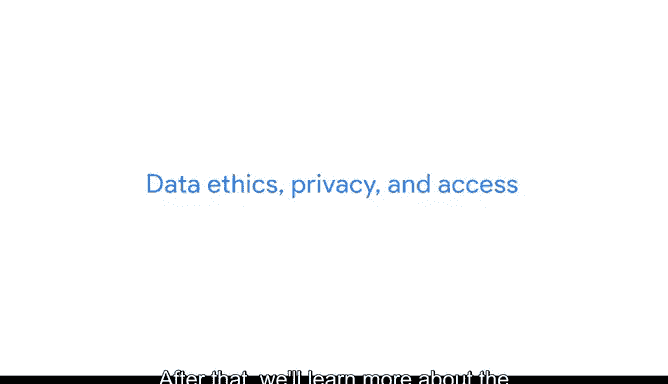

# 谷歌数据分析师第三课《为数据探索做准备》data-preparation（中英字幕）deepseek - P10：10_02_01_偏差、可信度、隐私与伦理导论.zh_en - GPT中英字幕课程资源 - BV19X4y1n7Xd

🎼Welcome back In an earlier course， we talked about how to prepare data in a way that helps you tell a meaningful story Now let's find out what comes next。

 like all good tales， your data story will be filled with characters， questions， challenges。

 conflict and hopefully a resolution The trick is to avoid the conflict overcome the challenges and answer the questions That's what this course is all about Here's how we'll do it First。

 you'll learn how to analyze data for bias and credibility。

 This is very important because even the most sound data can be skewed or misinterpreted then we'll learn about the importance of being good and bad Yep。

 just like when we were kids but in this case we'll be exploring good data sources and learning how to steer clear of their nemesis。

 bad data After that， we'll learn more about the world of data ethics。

 privacy and access As more and more data becomes available and the algorithms we create to use this data become more complex and sophisticated new issues keep popping up。

 We need to ask questions。

Like who owns all this dataHow much control do we have over the privacy of data can we use and reuse data however we want to As a data analyst。

 it's important to understand data ethics and privacy because in your work you'll make a lot of judgment calls on the correct use and application of data I'm excited to walk you through some of the questions。

 answers， risks and rewards involved Let's open up the first chapter of this data story in our next video。

