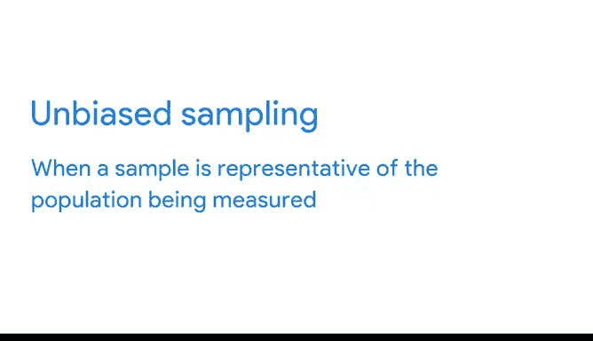
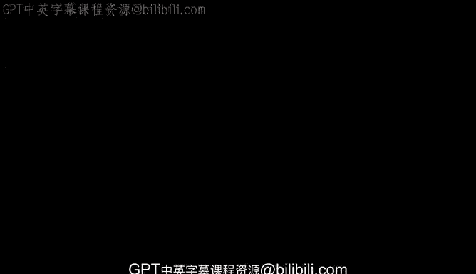

# 谷歌数据分析师第三课《为数据探索做准备》data-preparation（中英字幕）deepseek - P12：12_02_03_有偏数据与无偏数据.zh_en - GPT中英字幕课程资源 - BV19X4y1n7Xd

Hello again。 so far， we've learned that the biases we have as people can end up creating bias data。

 we're biased when we have preferences based on our own preconceived or even subconscious notions。

 When data is biased， it can systematically skew results in a certain direction。

 making them unreliable。😊，We covered this earlier using sampling bias as an example。

 Sam bias is when a sample isn't representative of the population as a whole。

 You can avoid this by making sure the sample is chosen at random so that all parts of the population have an equal chance of being included。

If you don't use random sampling during data collection， you end up favoring one outcome。

 Here's a simple way to look at it。Let's say there are 50 students in one class。

 and you want to know if the majority of the class prefers warm or cold weather。

 You decide to survey the first 10 students you meet。 and based on the responses。

 you determine that the entire class prefers warm weather。 But wait， there's some bias there。😊。

Those first 10 people were all women。 So only women were included in your survey。

 Your survey wasn't a fair representation of the entire class because it didn't include other identifiers across the gender spectrum。

 If you'd used a more randomized sample of the population that included all genders。

 you'd have an unbiased sample。Unbied sampling results in a sample that's representative of the population being measured。

Another great way to discover if you're working with unbiased data is to bring the results to life with visualizations。

 In the class example we just covered， you could visualize the number of students in the class overall and their gender identities with a bar chart。

😊，You could then compare that to a similar bar chart showing the students you surveyed。

 This will help you easily identify any misalignment with your sample。Okay。

 now that we know what bias looks like from a sampling perspective。

 let's explore some other types of bias and how to recognize them。

