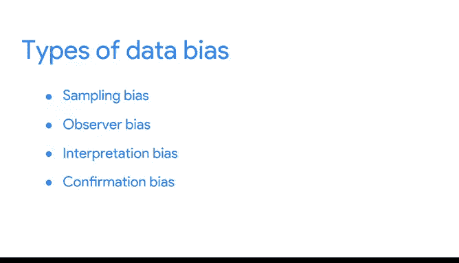

# 谷歌数据分析师第三课《为数据探索做准备》data-preparation（中英字幕）deepseek - P13：13_02_04_理解数据中的偏差.zh_en - GPT中英字幕课程资源 - BV19X4y1n7Xd

I may be bias， but I think learning about the good and the bad trait of data is pretty fascinating。

 Next up we'll discover that there's lots of different types of data bias beside sampling bias which we covered earlier as a quick refresher sampling bias is when a sample isn't representative of the population as a whole For example。

 if you're doing research on commuters and only survey people walking by in the sidewalk you'll miss out on input from people who ride bicycles drive or take the subway you need all sides of the story to avoid sampling bias In this video we'll explore three more types of data bias Ob bias。

 interpretation bias and confirmation bias and we'll learn how to avoid them let's start with observer bias。

 which is sometimes refer to as experimenter bias or research bias Basically it's the tendency for different people to observe things differently you might remember earlier we learn that scientists use observation a lot in their work like when they're looking at bacteria under a microscope to gather data while。

😊，Scientists looking into the same microscope might see different things。 That's observer bias。

 Another time observer bias might happen is during manual blood pressure readings。

Because the pressure meter is so sensitive。 health care workers often get pretty different results。

 Usually， they'll just round up to the nearest whole number to compensate for the margin of error。

 But if doctors consistently round up or down， the blood pressure readings on their patients。

 health conditions may be missed and any studies involving their patients wouldn't have precise and accurate data。

 Another common type of data bias is interpretation bias。

 The tendency to always interpret ambiguous situations in a positive or negative way。

 Here's an example。 Let's say you're having lunch with a colleague when you get a voicemail from your boss asking you to call her back。

 You put the phone down in a huff， certain that she's angry and you're on the hot seat for something。

 But when you play the message for your friend， he doesn't hear anger at all。

 he actually thinks she sounds calm and straightforward。

 Interpreation bias can lead to two people seeing or hearing the exact same thing and interpreting it in a variety of different ways。

 because they have different backgrounds and experiences。

 your history with your boss made you interpret the call one way while your。😊。

AndInted it in another way， because they're strangers。 Add these interpretations to a data analysis。

 and you can get bias results。The last type of bias we'll cover reminds me of the saying people see what they want to see。

 That pretty much sums up confirmation bias in a nutshell。

 Confirmation bias is the tendency to search for or interpret information in a way that confirms preexisting beliefs。

 Someone might be so eager to confirm a gut feeling that they only notice things that support it。

 ignoring all other signals。 This happens all the time in everyday life。

 We might get our news from a certain website because the writers share our beliefs。

 or we socialize with people because we know that they hold similar views。 After all。

 Coning viewpoints might cause us to question our worldview。

 which can lead us to changing our whole belief system。 And let's face it Change tough。 but。

 you know， it's even tougher doing good work when you have bad data。

 So it's important to keep bias out of it。😊，The four types of data bias we covered， sampling bias。

 observer bias， interpretation bias and confirmation bias are all unique。

 but they do have one thing in common。 They each affect the way we collect and make sense of the data。

 Unfortunately， they're also just a small sample pun intended of the types of bias you may encounter in your career as a data analyst。

 But the good news is， once you know a few， you'll find yourself constantly on guard for bias in any form。

 It's also important to remember that no matter what kind of data you use。

 all of it needs to be inspected for accuracy and trustworthiness。

 We'll talk more about that soon when we start exploring bad data。 By for now。😊。

