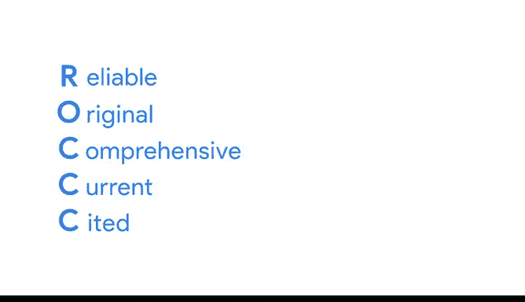

# 谷歌数据分析师第三课《为数据探索做准备》data-preparation（中英字幕）deepseek - P14：14_02_01_识别优质数据源.zh_en - GPT中英字幕课程资源 - BV19X4y1n7Xd

Hey， what's good。 No， really。 I want to know what is good。 Let me put it this way。

 If I asked you to name a good song， I might not like it。 That's because good is subjective。

 What I think is good and what you think is good might be different。 So what about good data sources。

 Are those subjective to。 In some ways they are。 But luckily。

 there's some best practices to follow that'll help you measure the reliability of data sets before you use them。

 That's what we'll discuss in this video。😊，I think we can all agree that we all want good data。

 The more high quality data we have， the more confidence we can have in our decisions。

 So let's learn how we can go about finding and identifying good data sources。 First things。 first。

 we need to learn how to identify them。 a process I like to call rock， R， O， C， C， C。 Okay。

 I just made that up。 But I think acronyms are a really great way to help new information to stick in the brain。

😊，Kicking things off are for a li， like a good friend。

 good data sources are li with this kind of data， you can trust that you're getting accurate。

 completete and unbiased information that's been vetted and proven fit for use。 Okay， on to O。

 O is for original。 There's a good chance you'll discover data through a second or third party source。

 to make sure you're dealing with good data。 Be sure to validate it with the original source。😊。

Time for the first C。C is for comprehensive。 The best data sources contain all critical information needed to answer the question or find the solution。

 Think about it like this。 You wouldn't want to work for a company just because you found one great online review about it。

 You'd research every aspect of the organization to make sure it was the right fit。

 It's important to do the same for your data analysis。 The next C is for current。

 The usefulness of data decreases as time passes。 If you wanted to invite all current clients to a business event。

 you wouldn't use a 10 year old client list。 The same goes for data。

 The best data sources are current and relevant to the task at hand。The last C is for sightted。

 If you've ever told a friend where you heard that a new movie sequel was in the works。

 you've cited a source。 Sidi makes the information you're providing more credible。

 So when you're choosing a data source， think about three things。

 Who created the data set Is it part of a credible organization and when was the data last refreshed。

 If you have original data from a reliable organization and it's comprehensive， current and cited。

 it rocks。😊。

There's lots of places that are known for having good data。

 Your best bet is to go with vetted public data sets， academic papers。

 financial data and governmental agency data。 Now that you know how to spot the good data。

 which rocks you're ready to learn about the mountain of bad data and how to avoid it。

 Let's get moving。😊。