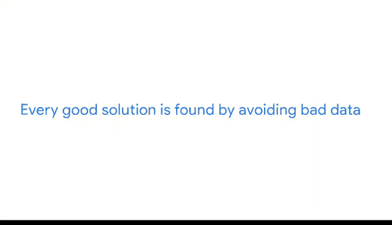

# 谷歌数据分析师第三课《为数据探索做准备》data-preparation（中英字幕）deepseek - P15：15_02_02_什么是劣质数据.zh_en - GPT中英字幕课程资源 - BV19X4y1n7Xd

Welcome back Last time we met we learned how to identify and find good data sources。

 a process I ended up coining rock we found that if the data is reliable， original， comprehensive。

 current and cited， it rocks， or more seriously it's good Hopefully this is refreshing your memory Now it's time to pull from what we learned about good data and apply it to today's lesson。

 bad data sources that don't rock。They're not reliable， original， comprehensive， current， or cited。

 even worse， they could be flat out wrong or filled with human error。We'll start again with R。

 R is for not reliable。 Bad data can't be trusted because it's inaccurate， incomplete or bias。

 This could be data that has sample selection bias because it doesn't reflect the overall population。

 or it could be data visualizations and graphs that are just misleading。

 Check out these two bar graphs， for example， The one on the left uses a y axis starting point of 3。

14%。 And the one on the right uses 0。 This makes it seem like interest rates have skyrocketed over a foury period。

 when they've actually remain pretty flat。Okay， on to O O is for not original if you can't locate the original data source and you're just relying on second or third party information。

 that can signal you may need to be extra careful in understanding your data。

Now C is for not comprehensive， bad data sources are missing important information needed to answer the question or find the solution。

 what's worse they may contain human error to。The next C is for not current。

 Bad data sources are out of date and irrelevant。 Many respective sources refresh their data regularly。

 giving you confidence that it's the most current info available。 For example。

 you can always trust data dot gov， which is home to the US government's open data。

 The last C is for not cited。 If your source hasn't been cited or vetted， It's a nogo。

 So to sum up good data should be original data from a reliable organization， comprehensivere。

 current and cited。 It should rock。 Otherwise， it's bad data。

 If you need a great reliable data source， check out the US Census Bureau。

 which regularly updates their information。It's important for data analysts to understand and keep an eye out for bad data because it can have serious and lasting impacts。

 whether it's an incorrect conclusion leading to one bad business decision or inaccurate information causing processes to fail and putting populations at risk。

Every good solution is found by avoiding bad data for good data。 St with vetted public data sets。

 academic papers， financial data and governmental agency data。 And with that。

 we've come to the end of our adventure with bias and credibility。 After a few more exercises。

 you'll be ready for what lies ahead。 I look forward to your progress。😊。

