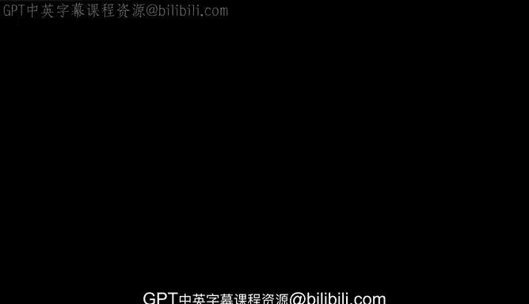
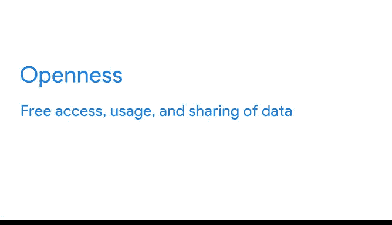

# 谷歌数据分析师第三课《为数据探索做准备》data-preparation（中英字幕）deepseek - P18：18_02_03_优先考虑数据隐私.zh_en - GPT中英字幕课程资源 - BV19X4y1n7Xd

We've been exploring some important aspects of data ethics and one of the most personal areas involves privacy privacy is personal。

 we may all define privacy in our own way and we're all entitled to it。

 whether it's family members wanting privacy when using a shared computer。

 a teenager wanting to share a selfie with only specific people or a company wanting to keep their customers' credit card info secure。

 we're all concerned how our data is used and shared。Data privacy is big in today's culture。

 so let's explore it fully when talking about data privacy means preserving a data subject's information and activity any time a data transaction occurs。

 This is sometimes called information privacy or data protection。 It's all about access。

 use and collection of data。 It also covers a person's legal right to their data。

This means someone like you or me should have protection from unauthorized access to our private data。

 freedom from inappropriate use of our data， the right to inspect， update or correct our data。

 ability to give consent to use our data and legal right to access our data。For companies。

 it means putting privacy measures in place to protect the individual's data。

 data privacy is important， even if you're not someone who thinks about it on a day to day basis。

 the importance of data privacy has been recognized by governments worldwide。

 And they've started creating data protection legislation to help protect people and their data。

 Being able to trust companies with your data is important。

 It's what makes people want to use a company's product， Share their information and more。

 Trust is a really big responsibility that can't be taken lightly。

The final aspect involving data ethics is one that's constantly being discussed。

 The idea of openness， free access， usage and sharing of data。 We'll cover that in another video。

 You're well on your way to becoming an ethical data analyst。

