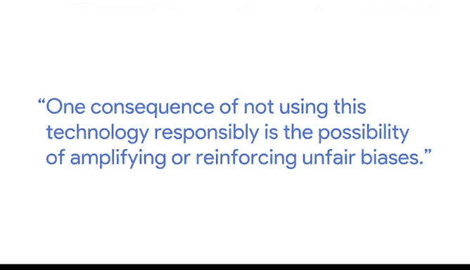
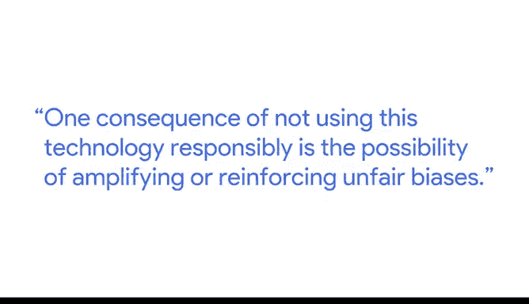

# 谷歌数据分析师第三课《为数据探索做准备》data-preparation（中英字幕）deepseek - P19：19_02_05_Andrew_数据的伦理使用.zh_en - GPT中英字幕课程资源 - BV19X4y1n7Xd

My name is Andrew， I am a senior developer advocate on the ethical AI research group at Google as a senior developer advocate I try and help the larger community build socially responsible AI systems one consequence of not using this technology responsibly is the possibility of amplifying or reinforcing unfair biases。

Now these algorithms， these data sets are often being used in settings where they're deciding the outcome。

 whether it's curating content for an individual or determining whether or not they're eligible for a loan。

 all these different decision making processes depend on the algorithms and the data sets that are。

Being used in that context and so if this were to be handled irresponsibly。

 then the very outcomes of these systems could potentially harm underrepresented communities minority groups there's a lot that the the field the industry the community is learning about the responsible use of data and AI so what I try to do is I try to collate all those different。

Elements， whether it's working with various research groups within Google。

 working with various product teams at Google， engaging with the larger community。

 we have to go above and beyond and actually educate。

Those that are striving to build this technology for good。

 but may not necessarily have the resources or the institutional community wisdom to actually carry out。

They're， their good intentions。 So the truth of the matter is that。

AI data and any technology that's built around that there's a lot of great benefits to that。

 you know it's improving the lives of many people out there。

 it's enabling us to do things we can inordinarily do it's providing us with affordances to think about other things in life this is all the more reason why it's important that we together collectively not just you know one organization but the entire community and even non-technologists too everyone needs to be involved that's the role that I play here is that I try to help AI evolve ethically together and to do that is contingent on the democratization of the responsible use of AI。

