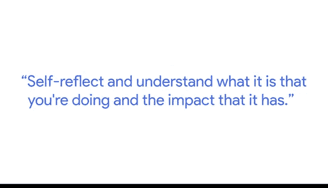

# 谷歌数据分析师第三课《为数据探索做准备》data-preparation（中英字幕）deepseek - P21：21_02_03_Andrew_伦理数据使用步骤.zh_en - GPT中英字幕课程资源 - BV19X4y1n7Xd

My name is Andrew， I am a senior developer advocate on the ethical AI research group at Google as an analyst there's。

Quite a few things you can do as you're evaluating your data set in order to ensure that you're looking at it through the various ethical lenses。

 one of which is being to self- reflectf and understand what it is that you're doing and the impact that it has。

And the best way to challenge that is to question who we are， we being like， okay。

 we in this team are trying to build this because we think that that's going to help improve this product or that's going to help inform decisions about what we want to do next。

 think about not just those that sit laterally next to you。

 but also think about those that are represented in this data and those that aren't represented in this data。

And then use that intuition to then continue to question the integrity， the quality。

 the representation that is present in that data and then also think about the various harms and risks associated with the work that you're doing you know。

 for example， if you find that you think that you'll benefit from keeping the data longer。

 you may want to also understand what's the risk of holding onto this data。

 what's the potential harm that could arise if you continue to look at the data and continue to store it and continue to retrieve this data and。

Going beyond that also understanding like what's the consent process like。

 are you informing those that you're collecting data from how it's going to be used。

 what's the communication channel like putting on the various ethical lenses。

Having taken a more nuanced approach to your analysis。

Being cognizant of all the possible risks and harms that can arise when not just analyzing your data set。

 but also。Presenting your data， how you portray the results。

 how they're being used in the decision making process。

 whether you are presenting this to management or presenting this to executives or presenting this to a larger audience all of that matters in the responsible use of the data as a data analyst。

 you stand in the intersection between the the very people that will stand to benefit from the technology that's being developed and those in your organization that are trying to make a more informed decision as to whether or not to move forward with the productionization of the technology it may feel like there's a lot of weight there and there is but。

It's also very pivotal and it speaks to the volume of the impact of your work。

