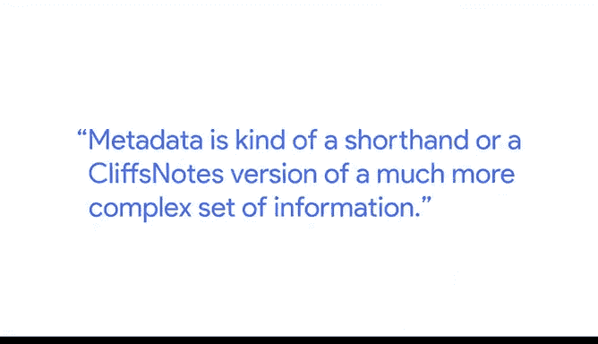
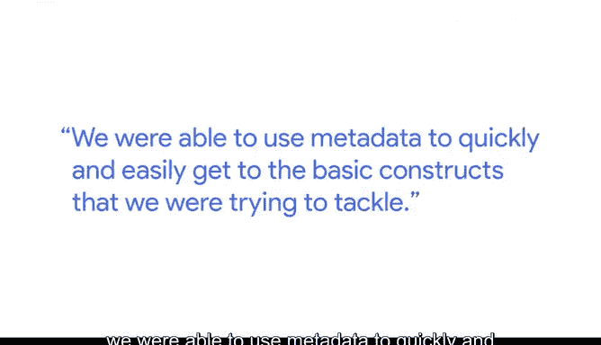
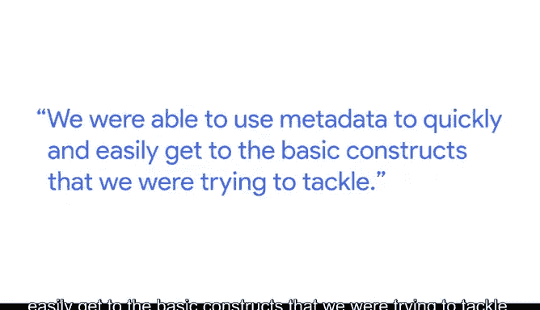

# 谷歌数据分析师第三课《为数据探索做准备》data-preparation（中英字幕）deepseek - P26：26_03_05_Megan_元数据的趣味应用.zh_en - GPT中英字幕课程资源 - BV19X4y1n7Xd

My name is Megan and I am an agency measurement lead here at Google basically I helped to demystify measurement and analytics for advertising agencies。

So people that are tasked with executing media plans for advertisers。

But also people that are interested in measuring the impact that media is having for their clients。

 So I've been doing this for about 17 years now。And have seen a lot of evolution in the space from data availability。

From different modeling techniques becoming more advanced， but also more accessible。

And it's just been a really cool journey to see how it's evolved。

 how analytics has become more mainstream and how people are getting more excited about it metadata is basically the key to your larger data set。

 it helps describe what's in the rows in the columns of the data that you'll be working with metadata is kind of a shorthand or a Clstone version of a much more complex set of information。

It can be helpful in just kind of helping you get a handle on what's in a single data set that you may have access to。

It's an important part of the discovery process of any analytics project as you're working with either a client or a vendor to understand the resources that you'll have to address a problem and what might be missing it just gives you you know the keys to unlock that data in a really simple and straightforward way and is a great communication tool when I was working for an advertiser one of the things that we were trying to do was build something called a data lake so essentially this is bringing together all of the sources of data that you might want to use in an analysis into one place which can be really really tricky one of the benefits of metadata was figuring out where we had sources that may overlap。

Where we had data sources that had things in common。

And what the unique pieces of information were that we were getting from each of those data sets。

 so as we thought about tackling this really huge and important project。

 we were able to use metadata to quickly and easily get to the basic constructs that we were trying to tackle。

When you're working with people who maybe don't have analytics is their day job。

 getting that aha moment。Helping them understand how measurement and analytics are tools that can help them achieve their goals is really important and just getting to that idea of you know。

 you made something that was previously inaccessible。

 a little bit more accessible for that team and something they feel comfortable putting into practice。

Is really important and really kind of a great way to come out of a partnership。

