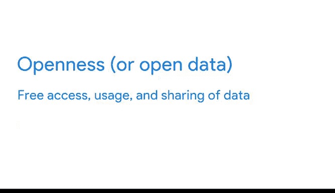

# 谷歌数据分析师第三课《为数据探索做准备》data-preparation（中英字幕）deepseek - P27：27_03_01_海量数据获取渠道.zh_en - GPT中英字幕课程资源 - BV19X4y1n7Xd

In this video， we'll discuss the different places data analysts go to connect with data。

 There's all kinds of data out there and it's important to know how to access it Earl。

 you learn that there are two basic types of data used by data analysts internal and external internal data is data that lives within a company's own systems It's typically also generated from within the company。

 you may also hear internal data described as primary data。

 Exnal data is data that lives and is generated outside and organization。

 It can come from a variety of places including other businesses， government sources， the media。

 professional associations， schools and more External data is sometimes called secondary data。

Gathering internal data can be complicated， depending on your data analytics project。

 you might need data from lots of different sources and departments， including sales， marketing。

 customer relationship management， finance， human resources and even the data archives。

 but the effort is worth it。 internal data has plenty of advantages for a business。

 it provides information that's relevant to problems you're trying to solve。

 and it's free to access because the company already owns it。With internal data。

 analysts can work on all sorts of data projects without ever looking beyond their own walls。

 but sometimes internal data doesn't give you the full picture。In those cases。

 data analysts can turn to external data and apply that information to their analysis。 For instance。

 as healthcare analysts， we often partner with other healthcare organizations or nonprofits and use their data to create deeper analyses and add a more industry level perspective。

In an earlier video， you learn that openness has created a lot of data for analysts use largely through open data initiatives。

 As a reminder， openness or open data refers to the free access， usage and sharing of data。

 For example， the United States government makes hundreds of thousands of data sets available to the public on data。

gov。

These data sets contain information on weather patterns， educational progress， crime rates。

 transportation， and much more。There are lots of reasons for these open data initiatives。

 One is to make government activities more transparent。

 like letting the public see where money is spent。 It also helps educate citizens about voting and local issues。

 Open data also improves public service by giving people ways to be a part of public planning or provide feedback to the government。

And finally， open data leads to innovation and economic growth by helping people and companies better understand their markets。

 Google actually hosts lots of public databases with information on science， transportation。

 economics， climate and more。 So as an example， a bike sharing company could use traffic data from within our public transportation database to see where the roads are busiest。

 then choose those locations for their bikes in order to reduce cars on the road and give people another transportation option。

😊，So now you're familiar with internal and external data and how you can access both Com up we'll learn how to import all the data you collect from different sources into a spreadsheet。

