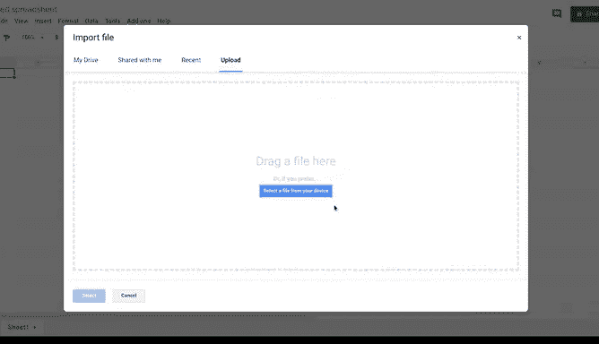
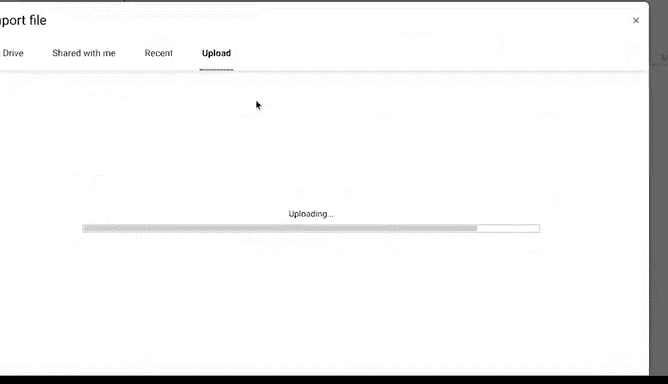
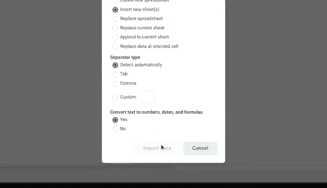
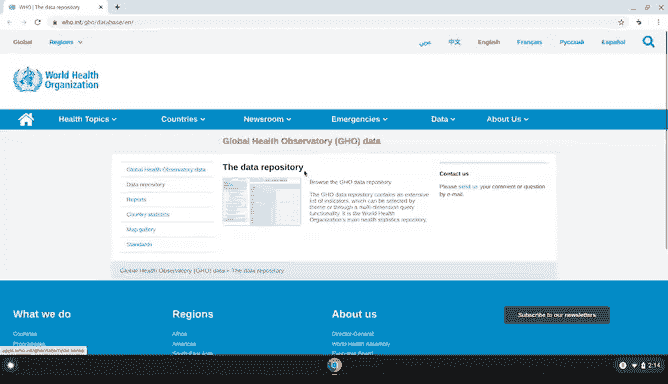
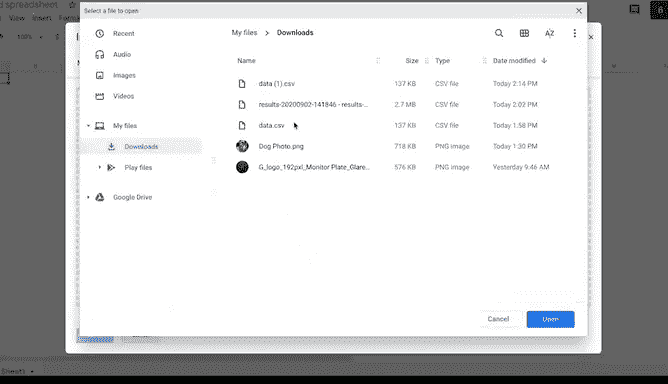
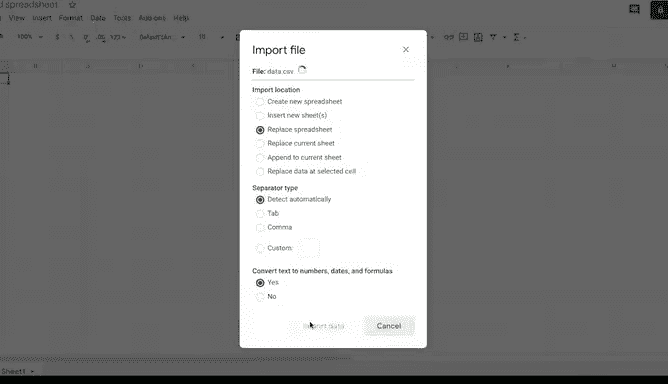

# 谷歌数据分析师第三课《为数据探索做准备》data-preparation（中英字幕）deepseek - P28：28_03_04_从电子表格和数据库导入数据.zh_en - GPT中英字幕课程资源 - BV19X4y1n7Xd

At this point you've learned all about internal and external data and how to prepare it for use Now we'll go through the process of actually importing data from different sources。

 sometimes you'll want to upload a spreadsheet from your files such as a CSV file CSV stands for comma separated values a CSV file saves data in a table format Now let's bring that file into a fresh spreadsheet。

We'll start by selecting a file， then import。Then we'll choose to upload a file。Navigate to it。

 open it and insert it as a new sheet。

CSV files use plain text and they're delineated by characters。

 so each column or field is clearly distinct from another when importing。

 as you learned CSVs are comma separated， and usually the spreadsheet app will auto detect those separations。

 but sometimes you might need to indicate that the separator is another character or a space by selecting the different options in this window。

Also， if you are planning to work with the data set， you would usually convert to text， numbers。

 or other options here， but plain text is okay for reporting purposes。

 so we can leave those fields alone， finally， select import data。

Now our CSV files ready to work with in our spreadsheet。

I spend most of my time at work analyzing spreadsheets full of healthcare information。

 I typically start by looking at a larger data， Then I pull a subset of it into a spreadsheet so I can work with it。

 Maybe I want to analyze year over year growth in user demand on Google search for certain healthcare services like telemedicine or maybe I want to look at data sets from external healthcare organizations or agencies for more insight into this trend。

 For example， with telemedicine， maybe I'll look at a spreadsheet that lists telemedicine providers。

 There are so many ways spreadsheets can help you find the insights you need。

 One source I use a lot is the world's health organization's data repository。😊。

This is a place where anybody can access open source data as you can see there's tons of data available。

 you can search by theme， category， indicator， and country。

 you can also access World Health Organization metadata if you want to learn more about the data in the repository。

For our example， we'll look at medical doctors by country and year。

This information would be useful for a data analysis project looking into how many doctors are available to treat patients within a certain population compared to other populations to get this data。

 we'll start on this webpage which contains the data we want。

 then we'll download the data as a CSV file。Then open a new spreadsheet and import the file by selectingF importm。

Next， upload your file and select importmport data。

After reviewing the data to make sure it looks clean， we can title it and begin our work。

I know this is a lot of information to take in， but you'll get much more comfortable with this the more you practice Com up。

 we'll learn how to sort and filter your data to focus on the information relevant to you。😊。

