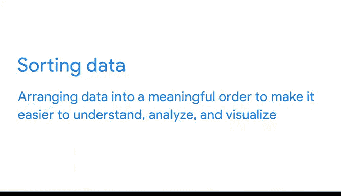
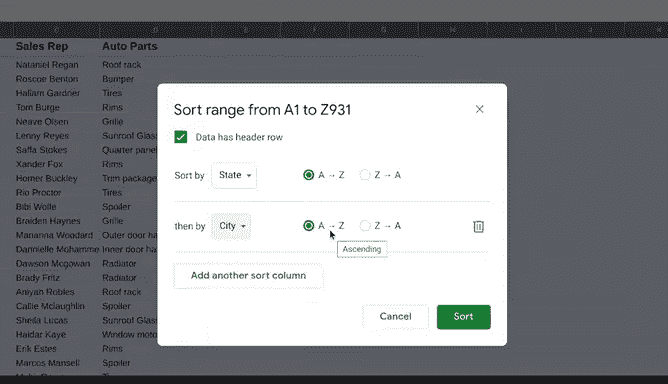

# 谷歌数据分析师第三课《为数据探索做准备》data-preparation（中英字幕）deepseek - P29：29_03_01_排序与筛选聚焦相关数据.zh_en - GPT中英字幕课程资源 - BV19X4y1n7Xd

In the past few videos， you've learned about both internal and external data now I'll show you how to focus on only the data that's relevant to the problem you're trying to solve。

This is useful if you're working with a very large complex spreadsheet。

 which data analysts encounter all the time。 having lots of data can make it difficult to quickly find and analyze the information you need。

 No two analytics projects are the same。 Often， data analysts process。

 view and use data very differently。 Even if it comes from the exact same source。 Here's an example。

 check out this spreadsheet that shows a company's sales reps and where they work。😊。

Different data analysts might want different information from this spreadsheet。

 and that's where sorting and filtering comes in。Sorting and filtering the data in a spreadsheet helps us customize the way data is presented。

 They can also organize data so analysts can zoom in on the pieces that matter。

 Think of it like a magnifying glass for our data。Let's begin with sorting Soing involves arranging data into a meaningful order to make it easier to understand。

 analyze and visualize Data can be sorted in ascing or descending order and alphabetically or numerically。

Sorting can be done across all of a spreadsheet or just in a single column or table。

 you can also sort by multiple variables， for instance。

 if our data contains both city and state fields， we can sort first by city and then by state。

Anytime you're sorting data， it's always a good idea to freeze the header row first。

 to do this will highlight the row。Then from the View menu， choose freezeze and One row。

This locks the row in place Now， when we scroll down the sheet， the header row stays visible。

 so we know the category of each column。Looks good to me， now let's sort the entire spreadsheet。

 we'll sort by City first to do this， select the city column。

Then use the drop down arrow to sort the sheet， select A to Z。

This will sort all of the columns from A to Z by row with the selected column being the primary sort criteria。

 the cities are now sorted alphabetically， and they're still grouped with the corresponding states。

 sales reps and auto parts。 The details across each row are automatically kept together when sorting a particular section。

 as you can see here。Multiple criteria sorting is another very useful data analysis tool。

 For instance， let's say we want to see a list of sales reps by the cities and states in which they work。

 First， we select the entire data set。😊，Then choose data and sort range。In the dialog box。

 make sure that data has header row is highlighted。That way， row A， city， states， sales rep。

 and auto parts won't be part of the sort。Then in the sort by drop down menu。

 select state and the sort order A to Z。Now add another sort column。In the then buy drop down。

 select City and the sort order A to Z。Finally， select sort。

Now we can search the data to easily find a sales rep who works in a particular state and city。

 sorting is useful when you want to look at everything in a spreadsheet in alphabetical or numerical order。

 but sometimes data analysts want to isolate a particular piece of information to do this。

 they use a filter。Filtering means showing only the data that meets a specific criteria while hiding the rest。

A filter simplifies a spreadsheet by only showing us the information we need。 For example。

 we could add a filter to see only the sales reps who work with a particular product。To do this。

 we first select data and create a filter。Choose the column with the data we need， in this case。

 auto parts。Filter buttons will appear in the corner of each column header。

To filter our spreadsheet by autopart， click the button in the auto parts header。In this example。

 let's say we want to only see sales reps who work with ris。

 remove the check marks from the categories we don't want to see， which is everything except for ris。

Then select， O。The filter temporarily hides anything that doesn't meet the condition。

 but note that even though they aren't visible， they're still there when it's time to view the entire area spreadsheet again。

 simply turn off the filter。Soting and filtering are very important tools in the data Analy toolbox in the next video you'll discover even more ways to narrow in on the exact information you need for any data analysis project。

😊。